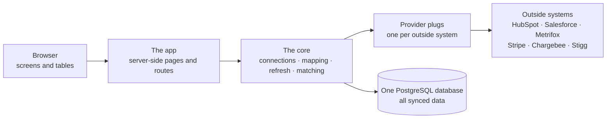
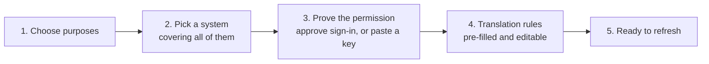
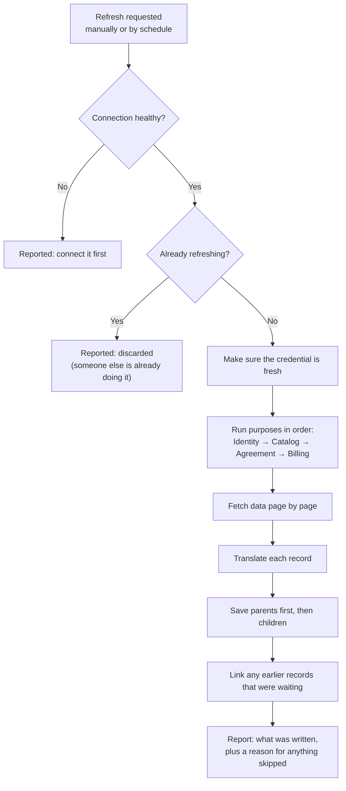
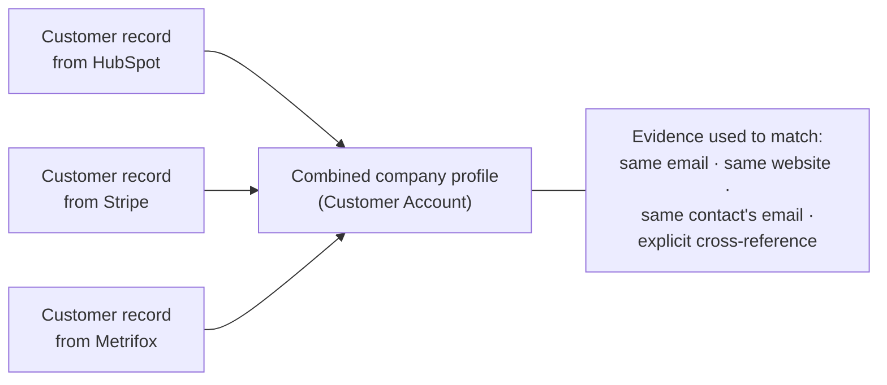

# Architecture — how the platform works

This document explains how the Integration Platform is put together and what
happens behind the scenes when you connect a system and bring data in. It is
written in everyday language; the technical names of things are included in
parentheses so you can match this document to what you see in the software.

For **what the platform stores**, see [`data-model.md`](./data-model.md). For a
quick orientation and the list of supported systems, see
[this folder's README](./README.md).

---

## 1. The system at a glance

There are three layers, plus the outside world:

- **The app** — the screens you use: connecting systems, editing translation
  rules, browsing synced data, reviewing combined companies.
- **The core** — the working engine: it holds permissions, fetches data,
  translates it, saves it, and matches companies across systems. It is kept
  deliberately separate from the screens, so the same engine can run from a
  command line or an automated test.
- **The database** — one PostgreSQL database holding everything: connections,
  translation rules, synced records, and combined company profiles.
- **Outside systems** — HubSpot, Salesforce, Metrifox, Stripe, Chargebee and
  Stigg, reached through their own public interfaces. Each has its own "plug"
  (called a **provider** in the software).

The core never assumes anything about a provider's shape. Providers are
interchangeable: adding one is adding a folder of plug files, not redesigning
the engine. The built-in Mock CRM is proof — it is a full provider, served like
any other, that runs with no credentials so the whole product can be
demonstrated.

## 2. The building blocks

| Term in the software | What it means |
|---|---|
| **Provider** | An outside system (HubSpot, Stripe, …) plus the knowledge of how to talk to it. |
| **Connection** (`Integration`) | One configured link to one provider account. It has a label, a status, a priority, and a refresh schedule. |
| **Purpose** (`Function`) | A kind of job the connection does. Seven are defined; four sync data today. |
| **Credential** | What proves the connection may read data: an approved sign-in, or an API key. Stored encrypted. |
| **Permission** (`Scope`) | One thing a provider allows, such as "read invoices". Requested based on chosen purposes. |
| **Translation rule** (`FieldMapping`) | "Take this field from the provider, clean it up if needed, store it as that field of ours." |
| **Refresh** (`Sync run`) | One execution of fetch → translate → save → report. |
| **Record** | One stored item: a customer, a contact, an invoice, and so on. |
| **Company profile** (`CustomerAccount`) | The combined view of one real company, built from matching records across connections. |

## 3. Choosing purposes determines permissions

This is the defining rule of the product. Permissions are not chosen one by
one, and they are not fixed per system. They are **derived from the purposes
you pick**.

- Each purpose needs different things from each system. Reading "identity"
  from HubSpot means companies, contacts and their field definitions; reading
  "billing" from Stripe means invoices, payments, charges and refunds.
- Because you can pick several purposes at once, the permission request is the
  **combination** (the union) of everything selected — no more.
- Because the platform knows what each purpose needs from each system before
  anyone signs in, the approval screen shows exactly the right list. Picking
  Identity alone will never ask for invoice access.

Three consequences worth remembering:

1. **A connection serves a *set* of purposes, not one.** One HubSpot
   connection can supply companies *and* tickets.
2. **A system only appears if it covers *every* purpose you picked.** Pick
   Identity + Billing and you will be offered only systems that can do both.
3. **New purpose, new permission.** If you add a purpose to an existing
   connection, the permission you granted earlier is narrower than what is now
   needed. The platform keeps a record of what was actually granted, notices
   the gap, and asks you to reconnect — instead of failing anonymously in the
   middle of a refresh.

### What is available today

| Purpose | Status | Systems |
|---|---|---|
| **Identity** | Ready | HubSpot, Salesforce, Metrifox, Stripe, Chargebee, Stigg, Mock CRM |
| **Catalog** | Ready | Stripe, Chargebee, Stigg |
| **Agreement** | Ready on four systems | Stripe, Chargebee, Stigg, HubSpot (deals and line items) |
| **Billing** | Ready | Stripe, Chargebee |
| **Support** | Not selectable yet | No handler; scope declarations remain for the roadmap |
| **Usage** | Not selectable yet | No handler; scope declarations remain for the roadmap |
| **Communication** | Not selectable yet | No handler; scope declarations remain for the roadmap |

Unbuilt functions are deliberately still visible on the New integration page,
marked "no sync yet" and disabled. The scope declarations keep the roadmap and
the consent rules honest; the capability layer requires a registered handler
before a function/provider pair can be selected or connected. That makes "no
system supports this yet" a state the software reports up front, rather than a
connection that authorizes and then syncs nothing.

## 4. Connecting a system

There are two styles of connection, and everything after the credential is
identical.

**Style A — approve a sign-in (OAuth).** HubSpot, Salesforce and Mock CRM. You
are sent to the system's own approval screen, sign in there, and approve the
requested access. The platform never sees your password. The system sends back
a credential plus a list of what was actually granted.

**Style B — paste an API key.** Metrifox, Stripe, Chargebee and Stigg. There is
no approval screen; the system issued you a long-lived key. You paste it, and
the platform checks it against the live service before saving.

| | Approve a sign-in (OAuth) | Paste an API key |
|---|---|---|
| Where it happens | Redirect to the provider's screen | A box in this app |
| Configured | Once per deployment (app registration) | Once per connection |
| Expires | Yes — refreshed automatically before it lapses | No — it lives until revoked |
| When it fails mid-refresh | Renew and retry once | Stop and ask for a new key |

Two rules apply to both styles:

- **Nothing is saved until the credential is proven.** A canceled approval or
  a mistyped key leaves no half-built connection behind. If a pasted key is
  rejected, your chosen system and purposes are kept so you can simply retry.
- **Reconnecting keeps your work.** If an existing connection loses access,
  reconnecting updates the credential but preserves your translation rules,
  synced data and combined company profiles.

## 5. Translation rules

Every system names and shapes its data differently. A **translation rule**
(also called a **field mapping**) says how one outside field becomes one of
ours:

> *Take `properties.domain` from HubSpot, run it through "keep only the
> domain", and store it as `customer.domain`.*

Each rule has four parts:

| Part | Meaning |
|---|---|
| Which purpose it belongs to | Identity, Catalog, Agreement or Billing |
| Which of our records it targets | A customer, a contact, an invoice line, and so on |
| Where the value comes from | The provider's own field path |
| Optional clean-up | Trim spaces, lowercase, extract a domain from a web address, or keep only the date |

Things that make the rules safe to use:

- **Targets are fully named, never guessed.** A rule must say *which kind of
  record* it writes to (`customer.domain`, not just `domain`). A contact field
  can never accidentally be saved onto a company.
- **Defaults are pre-filled.** Every connection starts with a sensible rule
  set, so it can refresh immediately. You only adjust rules you care about.
- **Suggestions come from the source.** The system asks the provider for its
  current field list (cached for an hour) to populate the dropdown, and still
  lets you type a field name by hand when the list cannot express it.
- **A rule for a field the record does not have stores a blank,** not a
  missing value. All records of a kind are shaped the same way, so nothing
  silently changes shape from one refresh to the next.
- **Anything extra is kept as a "custom field".** Provider fields that do not
  deserve a column of their own can be stored as key–value extras, up to 50 per
  record.
- **Cross-references are special.** A rule can record "this company is *that*
  account id in another system" (`crossRef.<provider>`), which the
  company-matching step treats as strong evidence. Only real, registered
  systems can be named this way.

### Formatting versus interpretation

A transform is formatting: trim, lowercase, extract a host, keep a date. It is
deliberately unable to map one vocabulary onto another. Provider words become
ours inside the handler, where the unknown-value policy is visible and tested:

| Kind | Unknown value policy |
|---|---|
| Optional enum status/type | Warn on the record, store null |
| Required discriminator | Reject, or a documented fallback with a warning |
| Provider boolean | Write nothing, so null keeps meaning "not told" |
| Provider list used as a filter | Fail closed only where the list is the sellable set, and say so |

HubSpot deals follow this rule. Name, `deal` type and currency are facts the
provider states in a shape we can use. Deal stage, closed flags, create date and
close date are kept raw in `providerMetadata`; they are not translated into
agreement status, effective date or end date. A closed-won deal is not an
active subscription, and a forecast close date is not an end date.

### Which rules produced a refresh

A rule set is mutable, so "the current mapping" cannot explain an older run.
Each function's rules are hashed to `v1-<sha256>` and that snapshot is written
to the `SyncRun` before the first provider request. The hash is independent of
row order, and `MAPPING_RULE_VERSION` changes when a deploy changes the meaning
of a rule. The mapping editor shows the current version; the run panel shows the
version that run used. An edit during a refresh affects the next refresh, not
the one already paging.

## 6. What happens during a refresh

A refresh is one complete pass: fetch, translate, save, report. Only
**active** connections refresh, and a connection refreshes one at a time.

### Why the order matters

Later purposes refer to earlier ones: an agreement belongs to a customer
(from Identity) and refers to an offering (from Catalog); an invoice refers to
a customer, an offering *and* an agreement. Running them in order means a
single refresh can fully connect everything, rather than producing records
that heal on the next run.

Inside each purpose, the same principle applies one level down. Systems hand
back *their own* account ids, never ours, so:

1. **Parents are saved first**, building a lookup from "provider id → our
   record".
2. **Children are then linked through that lookup** — a contact to its company,
   a price to its offering, an invoice line to its invoice. If a child refers
   to a parent written by an earlier refresh, the lookup falls back to the
   database.

If a parent genuinely cannot be found, the child is **kept with a blank link
and a warning**, and its provider id retained so a later refresh links it
automatically. Four kinds of children are the exception — agreement lines,
agreement entitlements, agreement discounts and invoice lines — because they
arrive together with their parent and mean nothing without it; if the parent
was refused, they are refused as a set. Payments are the opposite case: a
refund may have no invoice at all, so a payment can exist unlinked forever and
that is correct.

### Nothing is ever duplicated

Every synced record is keyed by *(connection + the provider's own id for it)*.
Re-running a refresh therefore **updates** the existing record instead of
creating a second one. That is why the instructions in the walkthroughs always
say "refresh again and confirm the counts do not move".

### A few lists are cleaned up on every refresh

Four kinds of child lists are **reconciled**: agreement lines, agreement
entitlements, agreement discounts and invoice lines. If something was removed
at the provider — an add-on taken off, a line deleted from a draft invoice —
the stored copy is removed too, with two safety gates: the list must be mapped
in the first place, and the provider must have signaled that it finished
sending. That second gate matters because a list cut short by paging looks
exactly like a genuinely shorter list.

Everything else is update-only. If a record stops arriving, it stays until the
connection is deleted. This is a known limitation (it is why a feature removed
from a plan can linger in the catalog), not a bug.

### One bad record never stops the job

Problems are recorded per record with a reason and a severity:

- **Skipped (rejected)** — the record cannot be stored meaningfully, for
  example a contact with a malformed email address. Email is a person's main
  identifier, and a broken one would poison later matching.
- **Warning** — the record is stored but something is off, for example an
  unrecognized company type, or a company link that could not be resolved.

The refresh finishes and reports **partial** with a full list of reasons, which
is far more useful than a single error that hides nineteen good records. A
refresh that had no issues reports **success**; one that could not continue
reports **failed**; one that found another refresh already running is
**discarded**; one whose worker stopped renewing its lease is **abandoned**.

Those statuses describe writes. The run also stores a separate **coverage**
report: pages and records read and written per object, whether the handler
declared each list complete, mapped objects it never yielded, supported objects
with no mapping, and whether a list stopped at the shared page guard. A success
can therefore be a success with unverified coverage, and the run panel says so
rather than calling a page-capped list fresh. The same row carries the mapping
version snapshot per function, so the rules behind the writes stay identifiable
after the mapping editor replaces them.

### One owner across instances

A refresh can outlive the request that started it, so "already refreshing?" is
not answered by an in-process variable alone. A worker claims the run in a
database transaction that locks the integration, creates the run with a lease
(owner, expiry, heartbeat and fencing token), and refuses if a live lease
exists. The worker renews the lease while it pages, writes and reconciles. If it
crashes, the lease expires; the scheduler marks the run **abandoned** and a later
worker can claim a new one. Closing is fenced on the same owner/token and checks
expiry again under the lock, so a paused old worker cannot overwrite the newer
run, advance `lastSyncTimestamp`, or change connection status after losing
ownership. The in-process lock remains only as a fast path for the common
double-click.

### Company matching runs afterwards

When the refresh finishes, the platform runs the company-matching pass
(section 7). It is deliberately kept separate and its failure never marks the
refresh as failed — the data that arrived is already safely stored.

## 7. Bringing one company together

A refresh is per connection; company matching is **per owner**, because no
single connection can see that the same company exists in three of them.

### What counts as evidence

| Evidence | Strength |
|---|---|
| An explicit cross-reference (this id over there is that id over here) | Strongest |
| A shared company email address | Strong |
| A shared website domain | Standard |
| A shared contact's email address | Standard |

The order matters when two different profiles could match: the stronger kind of
evidence wins. Free email providers (gmail.com and the like) are refused as
website evidence — otherwise every customer using a free mailbox would merge
into one giant company.

### Which account a key belongs to

A key's value for a tenant-scoped provider carries a scope segment, and that
scope is now a stored fact rather than a string recomputed from the latest token
metadata. `Integration.sourceAccountId` records the org/portal/site (or `""`
for a global provider), captured when the credential is established. HubSpot's
portal id comes from its token-info endpoint because the exchange body omits it.
A credential that cannot name its account leaves the column null and emits no
self-key; an unscoped numeric id would merge unrelated tenants.

Each `CustomerAccountKey` snapshots the account and the provider record that
offered it. That supports three distinct lifecycle rules:

- **Re-keying to another account retires keys.** The old account's claims are
  deleted before the new credential can match anything. If the column was never
  populated, the keys' own account snapshots are enough to detect the move.
- **Deleting a connection retires only that connection's keys.** Keys held by
  surviving members of the account remain, and the empty account shell is reaped
  by the next pass.
- **Absence does not retire.** `lastSeenAt` moves whenever a key is re-offered,
  but a key that simply stops being emitted stays put. Missing evidence is not
  deletion, and splitting an account on a transient omission would be worse than
  a stale join. Age-based pruning, if ever added, must be a separately stated
  policy.

### What the matcher will not do

- **It never merges two already-combined companies on a guess.** If two
  profiles both claim the same email, the platform raises the clash for a
  person to review instead of choosing. A wrongly merged company has no
  automatic undo, so guessing is the one move that is never worth it.
- **It never splits on the absence of evidence.** If a cross-reference stops
  being supplied, the company it already formed is not taken apart.
- **It never overrules a person.** Verdicts recorded on the Accounts screen —
  "same company" or "not this company" — outrank every automatic signal and
  survive every later pass.
- **It never uses priority to change who is grouped.** Priority (a number per
  connection, lower wins) only decides whose version of a *field* is shown
  when systems disagree. Membership is decided by evidence alone.

### Merging the details

Once records are grouped, each field of the combined profile is decided
separately:

- **The highest-priority connection that actually has a value wins.** A system
  that has nothing on file does not blank out another system's value, so
  "missing" never beats "present".
- **The Accounts screen shows which source record and evidence supplied each
  field** (a provider chip whose tooltip names the record, field, value and
  observation time), so the combined profile never looks like it came from
  nowhere.
- **Losing values are retained, not discarded.** Every field records the losing
  value, its source record and why it lost — lower priority or an equal-priority
  tie-break. Shared custom-field keys are stored per key
  (`customFields.<name>`) and reviewed the same way.
- **Creation date is the one exception:** it takes the *earliest* date any
  system reports. If a CRM saw the company in 2019, the company existed in 2019.
- **Where equal-priority systems disagree on a value, the conflict is shown**
  rather than an arbitrary pick dressed up as a decision.

## 8. When things go wrong

| Situation | What happens |
|---|---|
| A sign-in permission is close to expiring | Renewed quietly before it lapses. |
| A sign-in permission cannot be renewed | The connection is marked **needs reconnect** and pauses. Reconnecting keeps all prior work. |
| An API key stops working | Same: **needs reconnect**, preserved settings. |
| The provider asks the platform to slow down | It waits as instructed and repeats the same request, so a long fetch resumes where it left off rather than starting over. |
| A temporary provider outage | The whole refresh is retried with increasing waits, up to a limit. |
| One record is malformed | That record is skipped or flagged, with a reason; everything else is saved; the refresh reports **partial**. |
| Two refreshes are requested at once | One runs; the other is told it was **discarded**. Nothing is silently ignored. |
| A worker crashes mid-refresh | Its lease expires; the run is marked **abandoned**, and a later worker starts a fresh run with a higher fencing token. |
| A refresh fails completely | Everything already saved stays saved; the next scheduled refresh tries again. |
| A connection is deleted | Its synced records go with it. If the provider could not be reached to revoke access, the deletion still completes and the failed revocation is recorded in the server log, so the provider key can be revoked by hand. |

The guiding rule is **fail small**. A problem with one record, one page, or one
purpose fails only that scope, and reports exactly what happened — the
alternative, losing an entire refresh over one bad row, is what makes
integration tools untrustworthy.

## 9. Keeping data safe

- **Credentials are encrypted** with AES-256-GCM before storage, using a key
  that must be supplied at deployment. There is deliberately no built-in
  default key: a key that ships with the code is not protection. Credentials
  are never shown in the interface and never written to logs.
- **Sign-in passwords are hashed** with scrypt; sessions are signed, and every
  page sits behind the sign-in gate.
- **Everything is scoped to its owner.** Connections, records, combined
  profiles and translation rules all belong to one owner account, and every
  read and write carries that owner in its conditions. This is the most
  important safety property in the system: the failure to prevent is not a
  missed match (visible, fixable) but one owner's customers appearing under
  another owner's company.
- **Approval redirects are protected** against tampering with a single-use,
  expiring code: a callback that does not present a code the platform issued is
  refused, and two simultaneous callbacks bearing the same code cannot both
  succeed.
- **The scheduled refresh endpoint requires a secret** in production, so it
  cannot be used by strangers to make the platform call providers on demand.
- **Practice systems are off by default.** Mock CRM and the built-in Metrifox
  stand-in only run when a deployment deliberately enables them.

## 10. What runs where

| Piece | Role |
|---|---|
| **Pages** | Read stored data and render it (integrations, synced data, catalog, agreements, billing). |
| **API routes** | The only things that change data: create a connection, save rules, start a refresh, record a verdict, import a crosswalk. |
| **Scheduled refresh** | A worker pings the platform's refresh endpoint about once a minute; the platform runs whichever connections are due. A platform scheduler can do the same job in deployment. |
| **Provider plugs** | Talk to the outside systems. They contain no direct database access — the core hands them everything they need — which is what lets them be tested against a simulated provider. |
| **Practice mode** | An internal stand-in for Metrifox and the full Mock CRM, served over real web requests, so the real provider code runs unchanged with no credentials. |

## 11. Adding a new system or purpose

The design goal is that **adding is extending, not rebuilding**:

- **A new system that connects like an existing one** is a folder of plug files
  plus registration lines: how to authenticate, how to page through each kind
  of data it offers, which fields exist, and what sensible default rules look
  like. The engine, the screens and the database do not change.
- **A new purpose** is registered once, and appears in the picker immediately —
  correctly reporting "no system supports this yet" until a system plug is
  added for it. If it stores new kinds of records, those get their own storage
  definitions and translation targets.
- **A genuinely new *kind* of connection** (for example, the first key-based
  system after only sign-in systems existed) is the expensive case, because the
  connection flow itself must learn the new style. Once taught, every later
  system of that kind is cheap again — which is exactly how Stripe, Chargebee
  and Stigg were added after Metrifox pioneered key-based connections.

## 12. For engineers: where this lives

The repository's [`README.md`](../README.md) has the full engineering guide.
The short version:

| To change | Look at |
|---|---|
| Which purposes and systems exist, and their permissions | `src/core/bootstrap.ts` — every registration is in this one file |
| Which fields translation rules may target | `src/core/object-schema.ts` and the per-purpose schemas beside it |
| Which records a purpose writes, and in what order | `src/core/object-schema.ts` (`FUNCTION_OBJECTS`, `FUNCTION_WRITE_ORDER`) |
| How a system is paged or queried | `src/core/providers/<system>/<purpose>-handler.ts` and `api.ts` |
| The field dropdown and default rules | `src/core/providers/<system>/discovery.ts`, `defaults.ts` |
| Retry and rate-limit behavior | `src/core/providers/http.ts` (one request) and `src/core/sync/sync-engine.ts` (one refresh) |
| Database access | `src/core/repositories/` |
| Connection status rules | `src/core/repositories/integration-repository.ts` |
| The schedule | `src/core/sync/scheduler.ts` |
| What counts as matching evidence | `src/core/identity/evidence.ts`; winner rules and losing values in `survivorship.ts`; provenance read compatibility in `provenance.ts`; address normalization in `normalize.ts` |
| Which account a key belongs to, and when it is retired | `src/core/identity/source-account.ts`; source snapshots and freshness in `src/core/repositories/identity-repository.ts`; key cleanup on disconnect in `integration-repository.ts` |
| The database schema | `prisma/schema.prisma` — described in [`data-model.md`](./data-model.md) |

Tests are arranged in three layers: pure logic (`tests/unit`), the invariants
that must always hold (`tests/property`), and provider plugs exercised against
simulated provider APIs plus the matching pass against a real database
(`tests/integration`).
