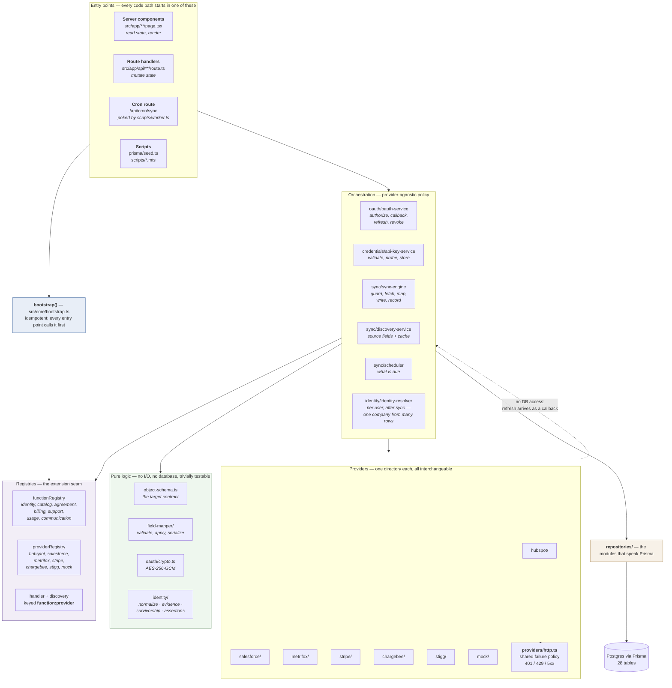
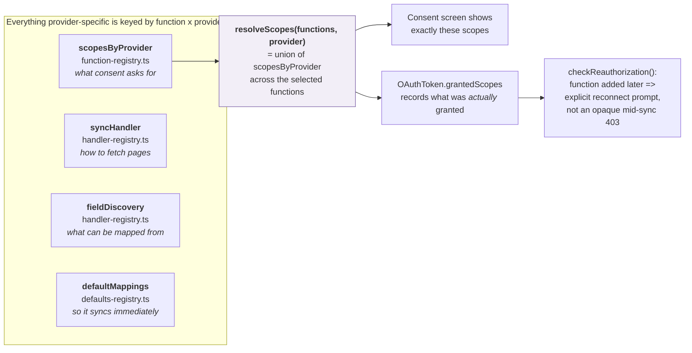
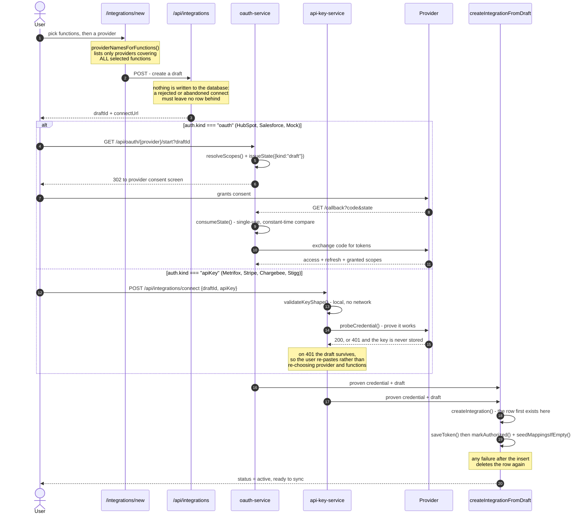
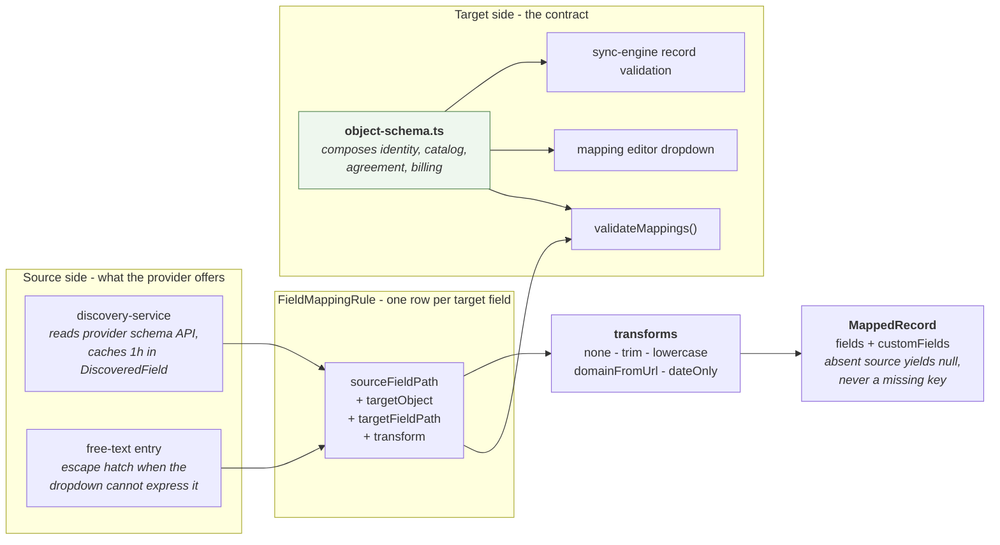
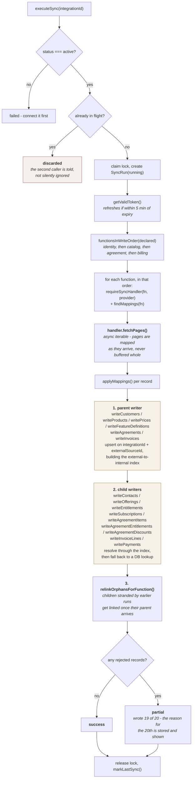
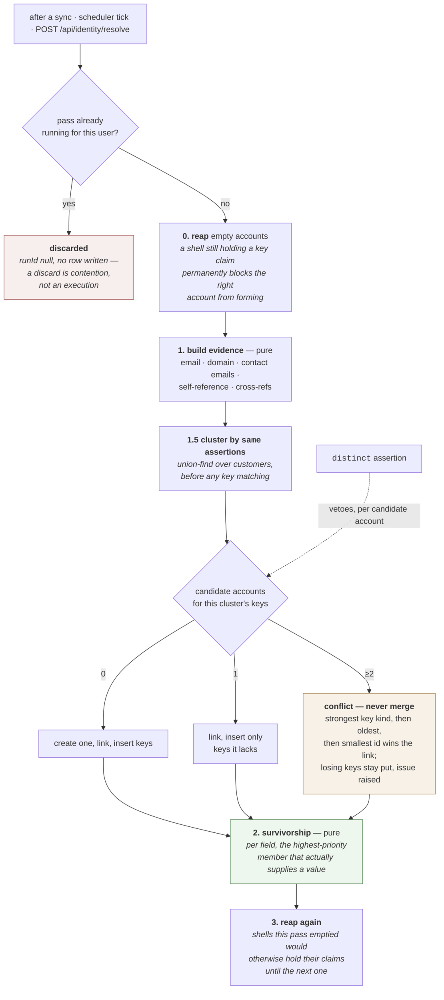
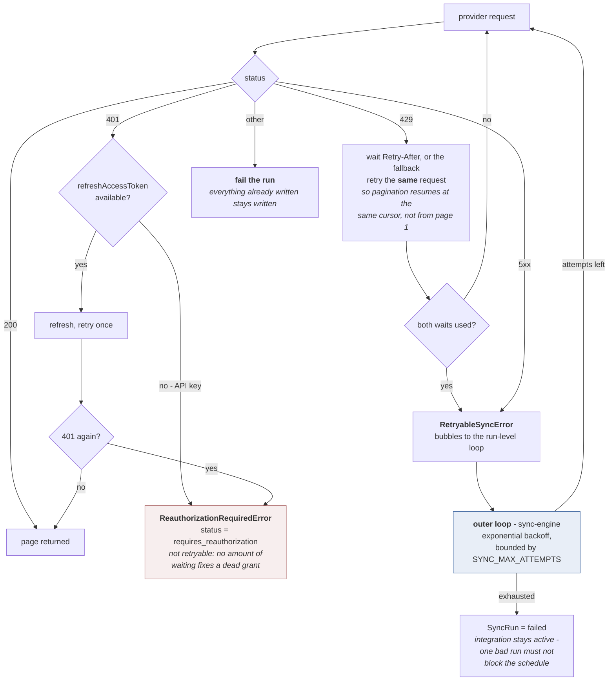
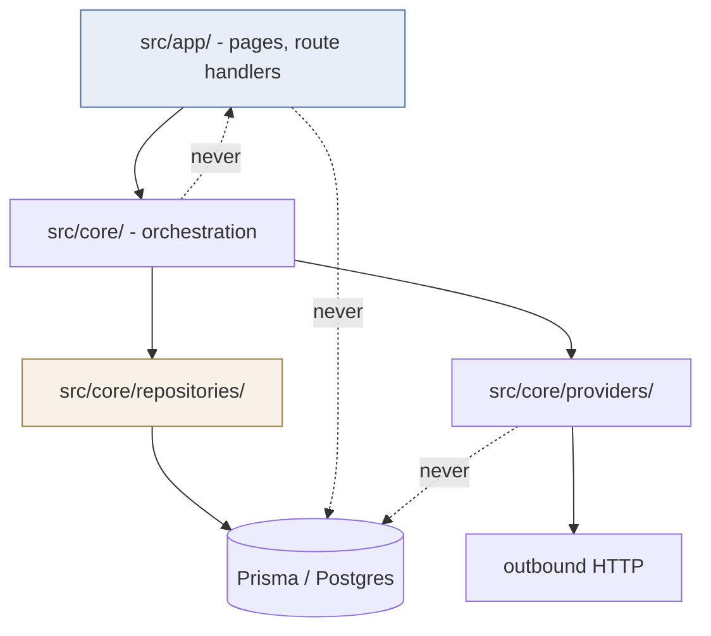
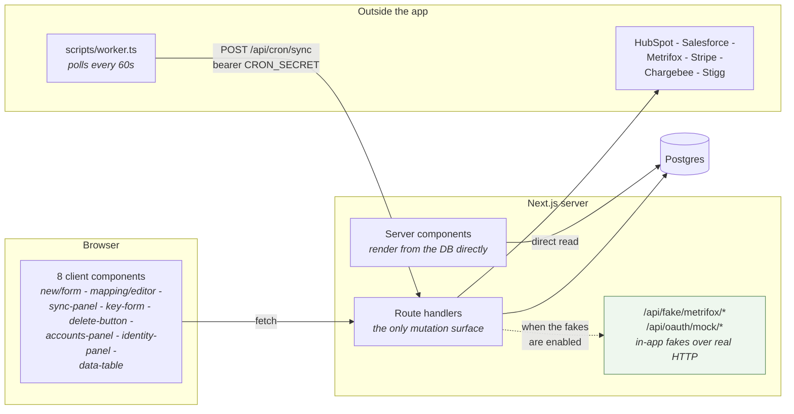

# Architecture

A map of the codebase for someone who has never opened it. The
[README](../README.md) explains *what the platform does* and *why the decisions
went the way they did*; [`data-model.md`](./data-model.md) covers the
twenty-eight tables. This document covers **where the code lives and how a
request moves through it**.

Read the first two sections and you can find anything. The rest is one section
per aspect, each answering a single question.

> **The diagrams below also exist as an interactive page** —
> [`docs/diagrams/index.html`](./diagrams/index.html). Same nine diagrams, but
> zoomable, hover-to-isolate, dark-mode, and with a live `resolveScopes()`
> matrix in §2. Open it in a browser; it needs no server.

---

## 1. The whole system in one picture

Four entry points, one framework-free core, one database. The core never
imports Next.js; the app layer never talks to Prisma directly (with two
documented exceptions, noted in §9).

**The one rule that shapes everything:** `src/core/` is framework-free. It has no
`next/*` imports, so the sync engine, the OAuth flow and every provider can be
exercised from a plain script or a test with no HTTP server running. `src/app/`
is a thin adapter — parse the request, call a core function, shape a response.

---

## 2. The one idea, and why the code is shaped around it

> **An integration declares which _functions_ it serves, and that declaration
> determines the OAuth scopes requested.**

That single sentence explains most of the structure. Because scopes depend on
*both* the function and the provider — HubSpot's scopes are granular, Salesforce's
`api` scope already covers everything — nothing can be keyed by function alone or
provider alone. So the central data structure is a **grid**:

Three consequences worth internalising before reading any file:

| Consequence | Where you see it |
|---|---|
| An integration serves a **set** of functions, not one | `IntegrationFunction` is one-to-many; `resolveScopes` takes an array |
| A function can be **declared without being built** | `usage`/`communication` are registered with no handler, so "no provider supports this yet" is a real, reachable state. `support` has scopes on both CRMs and no handler anywhere; `agreement` is declared on all five providers but only Stripe and Chargebee can serve it |
| A provider is **added, not wired in** | New directory under `core/providers/` + one call in [`bootstrap.ts`](../src/core/bootstrap.ts). No orchestration code changes. |

---

## 3. Connecting — two credential kinds, one destination

The trickiest thing to hold in your head is that **there are two ways to get a
credential and they converge**. `ProviderDefinition.auth` is a discriminated
union (`kind: "oauth" | "apiKey"`), so the compiler forces every branch to be
handled rather than letting an API-key provider quietly assume a token endpoint.

The ordering above is the point: every credential is proven *before* an
`Integration` row exists. A first connect that fails leaves nothing to clean up.
Reconnecting an integration that already exists is the one path that keeps the
old behaviour — it sets `status = error` and preserves the row, because by then
it may carry edited mappings and synced records that a delete would destroy.

**What differs, and what deliberately does not:**

| | OAuth | API key |
|---|---|---|
| Credential arrives | Redirect + consent | Paste box |
| Configured per | Deployment (`.env` client id/secret) | Integration |
| Expiry / refresh | Yes — proactive, 5 min leeway | Never; `isNonExpiring` keeps it off the refresh path |
| 401 during sync | Refresh, retry once | Terminal — `refreshAccessToken` is *withheld* from the handler |
| Encryption at rest | AES-256-GCM | The same code path |
| Everything after the credential | — identical — | — identical — |

That last row is the payoff: pagination, mapping, writing, and the failure
policy have no idea which kind of credential they are running on.

---

## 4. Mapping — how a provider field becomes one of ours

[`object-schema.ts`](../src/core/object-schema.ts) is a single composed registry
read by four consumers that would otherwise drift apart: mapping validation, the
target dropdown, sync-engine record validation, and identity survivorship.
Target paths are **object-qualified** (`customer.name`, `contact.email`) so a
contact field can never be mapped onto a customer record and still validate.

Two details that surprise people:

- **A mapped-but-absent source field writes `null`, not nothing.** The output
  shape depends on the rule set, never on which fields a particular record
  happened to carry.
  ([`field-mapper.ts:178`](../src/core/field-mapper/field-mapper.ts#L178))
- **`readPath` walks own properties only.** Source paths are user-editable, so
  `constructor` or `__proto__` would otherwise reach up the prototype chain.
  ([`field-mapper.ts:142`](../src/core/field-mapper/field-mapper.ts#L142))

**Three kinds of target path, not one.** `resolveTargetField` returns a
`FieldDefinition`, the sentinel `"customField"`, or the sentinel `"crossRef"` —
a union rather than a boolean, so adding the third made the compiler point at
every consumer that had to handle it.

| Pattern | Means | Validated against |
|---|---|---|
| `name`, `email`, `domain` | A real column | `identity-schema.ts` |
| `customFields.<key>` | A single-segment JSON key | the pattern only — the key is whatever the user wants |
| `crossRef.<provider>` | "this company is *that* id over there" | **`providerRegistry`** — `crossRef.nonsense` cannot be saved |

The last one needed the only UI addition: the target dropdown is built from
`mappableFields()`, which returns `FieldDefinition[]` and cannot express a
cross-reference, so a "Same company in…" option is backed by a *provider*
dropdown rather than the free-text box custom fields get. A custom-field key is
arbitrary; a cross-reference segment must name a registered provider or it fails
validation.

---

## 5. Sync — the pipeline, and the one ordering that matters

**Why parents are written before children.** Providers return their *own* id for
the parent — HubSpot in an associations block, Salesforce as `AccountId`, Stripe
as a product id on a price — never our internal UUID. Writing that into a
foreign key produces a dangling reference. Parents go first to build the
`external → internal` index; a child that still cannot be resolved is **kept
with a null link and a warning**, the provider's id retained so a later run
links it. That ordering is why
[`record-writer.ts`](../src/core/sync/record-writer.ts) exists as its own module
rather than living inline in the engine.

The order itself is declared in
[`object-schema.ts`](../src/core/object-schema.ts) rather than hardcoded per
function — `identity: [customer, contact]`,
`catalog: [product, offering, price, feature, entitlement]`,
`agreement: [agreement, subscription, agreementItem, agreementEntitlement, agreementDiscount]`,
`billing: [invoice, invoiceLine, payment]`. Adding a function is a change there
and in the writer's switch, not another branch in this loop. `catalog` is the one
with three children of the same parent — an offering from a product, a price
from an offering, and an entitlement from *both* — and the entitlement resolves
against the same index the other two built. `billing` is the one where the
*first* entry is the parent both others attach to.

**`Feature` is the one root record on the catalog side.** It hangs off nothing,
so `externalRefsOf` returns `{}` for it and it is written wherever it appears in
the handler's yield order. `Entitlement` is the opposite — it names two parents
and neither is primary, so both resolve independently and a half-linked row says
which half.

**Why the *functions* are ordered too, which is newer.** Identity and catalog
share nothing, so their order never mattered. An agreement does: it references a
customer written by `identity` and an offering written by `catalog`, so running
it first leaves both links dangling until the next sync. `functionsInWriteOrder`
sorts them, which is why "connect four functions, sync once" produces fully
linked agreements rather than rows that heal on the second run. Billing sorts
last for the same reason one level up: an invoice resolves a customer from
`identity`, an offering from `catalog` and an agreement from `agreement`.

**An agreement and an entitlement are the records with two parents.**
`SyncHandler.externalRefsOf` returns a *map* keyed by object — `{ customer }` for
a contact, `{ product }` for an offering, `{ offering }` for a price,
`{ offering, feature }` for an entitlement, `{ customer, offering }` for an
agreement — because in none of those cases is either half the primary one. Each
resolves and warns independently, so a half-linked row says which half.

**One child whose parent id never appears in its payload.** A Stripe
`ProductFeature` is read from `/v1/products/{id}/features` and the response
names no product, so the handler injects the id from the URL it requested. Every
other association here is read off the record, which means a wrong one shows up
as a null or an unresolved warning; this one would link every row to the wrong
product and report success. It is also why the catalog has no relink pass for
entitlements: an attachment cannot arrive before a product it was fetched *from*,
so an unresolved parent means that product was rejected rather than late.

**And four exceptions to "keep the child".** An `AgreementItem`,
`AgreementEntitlement`, `AgreementDiscount` or `InvoiceLine` whose parent was
rejected is rejected too, because its foreign key is required: the row would be
an amount, a period or a discount about nothing. All of them come off the same
provider record in the same run, so a missing parent can only mean the parent was
itself refused.

**`agreementItem`, `agreementEntitlement`, `agreementDiscount` and
`invoiceLine` are the four reconciling writers, and that is a real obligation
rather than a tidy-up.** Each reconciles its rows against what the handler just
yielded, so a removed add-on or a discounted line that came off does not linger.
The deletion is closed behind two gates — the object being mapped, and the page
declaring itself complete — because a collection truncated by a page bound looks
exactly like a shorter one; see
[`object-schema.ts`](../src/core/object-schema.ts) and the writer's
`InvoiceLineReconcileContext`. `Entitlement` does **not** reconcile, which is why
a feature detached in Stripe persists on re-sync; there is no equivalent of the
`status=all` parameter that makes subscriptions work.

**Per-record failures never abort a run.** A `RecordIssue` carries
`severity: "warning" | "rejected"` — a malformed email rejects the contact
(a broken primary identifier poisons later matching), an unrecognised customer
type only warns. A malformed *account* email is the deliberate opposite: warned
about and nulled rather than rejected, because a customer's identity is `name` +
`externalSourceId` and discarding a whole company over one bad field is worse
than an empty column.

**Then identity resolution runs, outside all of this** — see §6. It is a
separate per-user pass, wrapped so that it cannot fail the sync that triggered
it.

---

## 6. Identity — one company out of three rows

Sync is **per integration**. Identity resolution is **per user**, and that
difference is the whole reason it is a separate pass rather than a step inside
`executeSync`: one real company appears as three `Customer` rows in three
connections, so no single integration can see the group. `sync-engine.ts` gains
no import from this; the two call sites go through
[`resolve-after-sync.ts`](../src/core/identity/resolve-after-sync.ts), which
holds the one policy that matters — **a sync is never reported failed because
resolution hiccuped**.

### The two conflicts, and why only one of them is a hierarchy

This is the distinction the whole design rests on, and conflating them is the
easiest way to build something dangerous.

| | The question | Resolved by `identityPriority`? |
|---|---|---|
| **Key conflict** | "Is this the same company?" — two accounts both claim `billing@acme.example` | **No.** Never auto-merged; the winner is deterministic, losing keys stay put, and a `key_claimed_elsewhere` issue asks a human. |
| **Value conflict** | "What is this company called?" — HubSpot says `Acme Manufacturing Inc`, Stripe says `Acme Corp` | **Yes.** This is the only thing the rank is for. |

**Priority changes what an account says, never who is in it.** If reordering
sources could repartition accounts, then nudging a number to fix a displayed
name would silently regroup someone's customer list — and nobody would connect
the two events. `identity-surfacing.test.ts` asserts the placements and the key
rows are *identical* across a priority change, not merely equivalent.

**A null is not an opinion.** Stripe has no `industry`, `domain` or `type` field
at all; HubSpot has no account-level `email`. So "the top-ranked source's row
wins wholesale" would be destructive — putting Stripe at priority 1 would blank
three columns on every account it touches. Each field is contested only among
the members that actually carry it, which is what lets the hierarchy compose:
Stripe wins `email`, HubSpot wins `industry`, neither erases the other.

`createDate` is the one declared exception, taking the **earliest** value rather
than the highest-priority one — if the CRM saw a company in 2019 it existed in
2019. Declared rather than special-cased, as `conflictPolicy` on the field
definition in `identity-schema.ts`, so the rule lives next to the field it
governs.

### Three ways a foreign id arrives

The spec calls Metrifox's `payments_stripe_customers` the join that makes one
customer account possible, and **no Metrifox endpoint exposes it**. So
`external_ref` — the strongest key kind — needs supply routes that do not depend
on a fetch.

| Route | Shape | Where |
|---|---|---|
| **Self-reference** | Free. Every customer contributes `<provider>:<scope>:<externalSourceId>` from data already in hand | `evidence.ts` |
| **Mapped field** | `crossRef.<provider>` target path, parallel to `customFields.<key>` — reuses the mapping editor, validation and transforms wholesale | `identity-schema.ts`, `Customer.crossRefs` |
| **Imported crosswalk** | Pasted or uploaded `<local id>,<foreign id>` pairs — the honest answer for a table no API serves | `identity/crosswalk.ts`, `Customer.importedCrossRefs` |

**The scope segment is not optional.** HubSpot object ids are portal-scoped, so
a bare `hubspot:12345` self-key would merge company `12345` in two different
portals into one company. Every provider declares
`externalIdScope: "global" | "tenant"`; a tenant-scoped one takes its scope from
the token's `providerMetadata`, and **if no scope value is available it emits no
self-key at all**. Failing closed costs a join, which is visible and
recoverable; guessing costs a false merge, which looks exactly like the matcher
working well.

That is not hypothetical: HubSpot's token response carries no `hub_id` (it is
only readable from an endpoint `parseTokenResponse` cannot call), so HubSpot
contributes no self-key today. Salesforce is scoped by `organizationId` rather
than `instance_url`, because legacy pod hostnames like `na1.salesforce.com` were
shared by thousands of unrelated orgs. Chargebee is scoped by its **site**, and
that one *is* available: the site's API keys are created per site, so the probe
that validates the credential returns the site it authenticated against and
stores it as `providerMetadata.site`. Two Chargebee integrations against two
sites therefore cannot merge on `chargebee:12345` alone — the exact failure the
scope segment exists to prevent, and the first provider to be able to avoid it.

### What the resolver will not do

Three refusals, each deliberate, each tested:

- **It never writes an assertion, only reads them.** That is what makes a human
  verdict sticky across a pass that otherwise recomputes everything.
- **It merges on evidence and never splits on the absence of it.** Withdrawing
  an imported crosswalk stops the pair being supplied; it does not take apart
  the account it already made. Only a `distinct` assertion separates records
  that are already grouped.
- **It never auto-merges two multi-member accounts.** A false merge is the worst
  failure any matcher has and it has no user-facing undo, so two rival accounts
  contest and raise an issue instead. The human routes — "same company" and "not
  this company" on the Accounts tab — are how a merge actually happens.

---

## 7. Failing well — two nested retry loops

This is the part most worth understanding before debugging a flaky sync, because
the two loops are easy to confuse. The inner one lives in
[`providers/http.ts`](../src/core/providers/http.ts) and retries **one request**;
the outer one lives in the sync engine and retries **the whole run**.

All waiting goes through an injected `Clock`
([`sync/clock.ts`](../src/core/sync/clock.ts)), so tests assert retry *schedules*
instantly instead of sitting through them.

---

## 8. Where do I look for X?

| I want to change… | Open |
|---|---|
| Which scopes a function asks a provider for | [`bootstrap.ts`](../src/core/bootstrap.ts) — every registration is in this one file |
| The fields a mapping may write to | [`object-schema.ts`](../src/core/object-schema.ts) — the composed
  registry the validator, UI and engine all read. The per-object definitions are in `identity-schema.ts`,
  `catalog-schema.ts`, `agreement-schema.ts` and `billing-schema.ts` beside it |
| Which objects a function writes, and in what order | `FUNCTION_OBJECTS` in [`object-schema.ts`](../src/core/object-schema.ts) — and `functionsInWriteOrder` for the order of the functions themselves |
| How a provider paginates or shapes its query | `core/providers/<name>/<function>-handler.ts` and `api.ts` |
| What the mapping editor offers as sources | `core/providers/<name>/discovery.ts` |
| The pre-filled mapping a new integration starts with | `core/providers/<name>/defaults.ts` |
| Retry / rate-limit behaviour | [`providers/http.ts`](../src/core/providers/http.ts) (per request) or [`sync-engine.ts`](../src/core/sync/sync-engine.ts) (per run) |
| Anything touching the database | `core/repositories/` |
| The status lifecycle | [`integration-repository.ts`](../src/core/repositories/integration-repository.ts); diagram in [data-model.md](./data-model.md#integrationstatus-lifecycle) |
| What runs on a schedule | [`sync/scheduler.ts`](../src/core/sync/scheduler.ts), driven by `/api/cron/sync` |
| What counts as evidence that two records are one company | [`identity/evidence.ts`](../src/core/identity/evidence.ts) — pure; every key the matcher will ever see is emitted here |
| Which source wins a contested field | [`identity/survivorship.ts`](../src/core/identity/survivorship.ts), ranked by `Integration.identityPriority` |
| How an email or domain is normalized before matching | [`identity/normalize.ts`](../src/core/identity/normalize.ts) — and `EMAIL_PATTERN` lives here, imported by the record writer, so validating and matching cannot drift |
| Which domains are refused as match keys | [`identity/free-email-domains.ts`](../src/core/identity/free-email-domains.ts) |
| Moving existing connections onto a changed default | [`identity/mapping-retarget.ts`](../src/core/identity/mapping-retarget.ts) + `npm run mappings:retarget` |

### The provider directory, as a template

Every provider is the same five-to-nine files, one handler per function it
serves. That uniformity is the point — adding one is filling in a known shape,
not designing anything.

| File | Role | Required? |
|---|---|---|
| `provider.ts` | `ProviderDefinition` — name, label, `auth` union member, scope constants, `externalIdScope` | yes |
| `<function>-handler.ts` | `fetchPages()`, `externalIdOf()`, `externalRefsOf()` | one per function served |
| `api.ts` | Base URL, page size, endpoint paths — env-overridable so tests can retarget them | in practice |
| `discovery.ts` | Reads the provider's schema API for the source dropdown. One instance serves every function it switches on internally; the registrations are per `(function, provider)` | optional — absent means free-text only |
| `defaults.ts` | Suggested starting mappings | optional — absent means an empty editor |
| `fixtures.ts` / `fake.ts` | Canned data, and/or the static field list discovery unions with | mock and Metrifox have both; Stripe has `fixtures.ts` and no fake, because its CLI seeds a real sandbox instead; Chargebee has `fixtures.ts` for the msw suites |

The largest directories here are **Chargebee's and Stripe's, at nine files
each**, and they are still exactly this template: four handlers (identity,
catalog, agreement, billing), a `provider.ts`, an `api.ts`, a `discovery.ts`, a
`defaults.ts`, a `fixtures.ts`.
Which is the point the README makes about Stripe, repeated — a new function on
an existing provider is a new file and a registration, not a redesign.

---

## 9. Layering rules — and the two places reality bends

Enforced by convention, not by tooling. Two accurate caveats, since the point of
this document is that you can trust it:

1. **`sync-engine.ts` and `record-writer.ts` import `prisma` directly**
   ([sync-engine.ts:10](../src/core/sync/sync-engine.ts#L10),
   [record-writer.ts:12](../src/core/sync/record-writer.ts#L12)) for `SyncRun`
   bookkeeping and the record upserts. So "repositories are the *only* layer
   importing the Prisma client" is the intent, with these two as the exception.
2. **`app/integrations/[id]/page.tsx` imports `prisma`**
   (`src/app/integrations/[id]/page.tsx:16`) for a read the repositories do not
   expose. It is the only app-layer file that does.

The identity pass is the counter-example that shows the rule is affordable:
`identity-resolver.ts` orchestrates a whole multi-phase write and imports no
Prisma client at all, going through
[`identity-repository.ts`](../src/core/repositories/identity-repository.ts) for
every query. That file exists so **every write and every match query is scoped
by `userId` in one reviewable place** — a single missing `userId` merges two
tenants' companies, which is the severe failure in this schema. Account *reads*
for the Accounts tab deliberately live in `synced-data-repository.ts` instead: a
read-only projection for a page is not part of the matcher, and putting it in
the guarded file would only enlarge the surface being guarded.

Everything else holds: no `src/core` file imports from `src/app`, and no
provider file imports the database or the OAuth service — token refresh reaches
providers as a **callback on `HandlerContext`**, which is precisely what lets
`tests/integration/` exercise real pagination and 401-refresh-retry paths against
msw with no Prisma client in the process.

### Two singletons on `globalThis`, and two tables that used to be singletons

The sync in-flight lock hangs off `globalThis`, and the Prisma client does too
outside production. Next compiles route modules separately and re-evaluates them
on hot reload, so a plain module-level `Set` would let two concurrent requests
each believe they held the sync lock. For Prisma the failure mode is a leaked
connection pool per reload, which is why production gets a plain instance
instead.

The OAuth state store and the connect draft store were on `globalThis` for the
same reason and are now tables (`OAuthState`, `IntegrationDraft`). Hot reload was
only half the problem: both are written by one request and read by another, so on
a host that runs more than one instance the second request reaches an instance
that never saw the write. Every callback fails state validation, and every draft
is "expired" by the time its connect page renders. A table answers both, and the
single-use property of state comes out stronger — `consumeState` deletes the row
it reads, so two concurrent callbacks race on one row and exactly one wins.

What remains genuinely single-instance is the sync lock, which fails safe: the
worst case is one integration synced twice at once, not a broken connect.

---

## 10. What runs where

Pages read state; route handlers change it. The mock provider and the Metrifox
fake are served **over real HTTP from routes inside this app**, so the real
clients run completely unchanged — real headers, real pagination, real status
codes, real failure policy. That is why the whole flow is walkable with no
credentials at all.

---

## 11. Adding things — the two recipes

**A new provider** that shares an existing credential kind:

1. `mkdir src/core/providers/<name>/` and fill in the template from §8.
2. Add scope constants and export a `ProviderDefinition`.
3. In [`bootstrap.ts`](../src/core/bootstrap.ts): `registerProvider`, add the
   provider to the relevant function's `scopesByProvider`, then
   `registerSyncHandler` and `registerFieldDiscovery`.
4. Register defaults in
   [`defaults-registry.ts`](../src/core/providers/defaults-registry.ts).

No orchestration code changes. Introducing the *first* provider of a new
credential kind is a different matter — Metrifox required splitting
`ProviderDefinition.auth` into a union and teaching the connect flow, the session
client and the refresh path about a credential that never expires. Every
API-key provider after that has been a directory and registration calls again.
Stripe was the first test, despite a differently shaped credential
(`Authorization: Bearer` plus a pinned API version, absorbed by `authHeaders` on
the session options) and cursor rather than page-number pagination. Chargebee was
the second, and a harder one: HTTP Basic with the site name as the username,
from a pasted `site:api_key` pair, a `tenant`-scoped external id keyed on that
site, **four** handlers at once — and still no orchestration, route or UI
change. Stigg was the third, and a fifth credential shape again: a custom
`X-API-KEY` header, opaque server-issued cursors, a synthesized billing contact,
and a `tenant`-scoped id whose scope is not knowable from the list API at all —
so it emits no identity key, the same honest fail-closed state Metrifox and
HubSpot are in. Registering it was a directory and registration calls, exactly
as this list predicts.

**A new function:** `registerFunction` with its `scopesByProvider`, and it
appears in the picker immediately — with no handler it correctly reports that no
provider supports it yet. Add a handler per provider to make it real, plus a
target schema alongside the existing four if it writes new record types.

Concretely, for a function that writes new objects, in the order the compiler
will ask for them:

1. Add the objects to `TARGET_OBJECTS` in
   [`types/common.ts`](../src/core/types/common.ts), plus any enum union they
   need. `OBJECT_SCHEMAS` is exhaustive over that union, so this step breaks the
   build until step 2 is done — which is the intended pressure.
2. Write `<function>-schema.ts` and register it in `object-schema.ts`, in
   `FUNCTION_OBJECTS` (parents first) and in `FUNCTION_WRITE_ORDER`.
3. Add the models to [`schema.prisma`](../prisma/schema.prisma) and
   `npm run db:push`.
4. Add the writers and a branch to `writeRecordsForFunction` /
   `relinkOrphansForFunction` in
   [`record-writer.ts`](../src/core/sync/record-writer.ts).
5. Provider side: a handler, a branch in that provider's `discovery.ts`
   (exhaustive on Stripe, so the compiler asks), field lists in `fixtures.ts`,
   defaults in `defaults.ts`, and registrations in `bootstrap.ts` and
   `defaults-registry.ts`.
6. The seams with no compiler and no test behind them, which is where a new
   object actually gets forgotten: the nav in `app/layout.tsx`, the
   delete-confirmation total in `app/integrations/[id]/page.tsx`,
   `OBJECT_LABELS` in `sync-panel.tsx`, and the unresolved-association report in
   `scripts/db-maintenance.mts`.

`billing` is the worked example of what that list looks like end to end: three
objects, one new page (`/billing`), four writers, one of which reconciles, and
five providers that changed nothing.

---

## 12. How the tests are layered

The three suites map onto the layers above, which is the fastest way to know
where a new test belongs.

| Suite | Exercises | Needs |
|---|---|---|
| `tests/unit/` | Pure logic — mapper, crypto, SOQL, clock, scheduler policy, the four object schemas, each provider's status/amount maps, identity normalization, survivorship, assertions, crosswalk parsing, the mapping migration | nothing |
| `tests/property/` | The invariants that carry weight: scope isolation, provider filtering, mapping round-trip, target validation, absent-source-yields-null, upsert identity, pagination completeness, and identity's own set below | fast-check |
| `tests/integration/` | Handlers against mocked provider APIs — pagination, 429 with and without `Retry-After`, 401 then refresh then retry, field discovery, one file per function per provider for catalog/agreement/billing — plus the resolution pass and the writers against a real database | msw, plus a throwaway Postgres schema built by `tests/global-setup.ts` |

`identity-resolution.property.test.ts` carries the properties that would be
tedious to argue by example: **totality** (every customer ends with an account),
**idempotence** (a second pass changes no partition *and* no account id),
**order-independence** (shuffling input rows yields the same partition), and
that **precedence never repartitions**.

Two things about the suite's shape are deliberate and easy to undo by accident:

- **Vitest runs test files in parallel forks against one shared Postgres
  schema.** An unscoped `findFirst` in a test is therefore a cross-test hazard,
  not a style preference. `tests/integration/identity-helpers.ts` builds an
  isolated tenant per test for exactly this reason.
- **The scheduler tick is not driven end to end.** `runScheduledSyncs` sweeps
  every integration in the database by design, so a test tick would sync and
  resolve tenants another file is mid-assertion on. `distinctOwners` is exported
  and unit-tested instead, and `resolveAfterSync` is covered against a real
  database.

`npm test` runs `tsc --noEmit` **first, as a gate**: Vitest transpiles without
typechecking, so a suite can otherwise pass green over a build that does not
compile.
