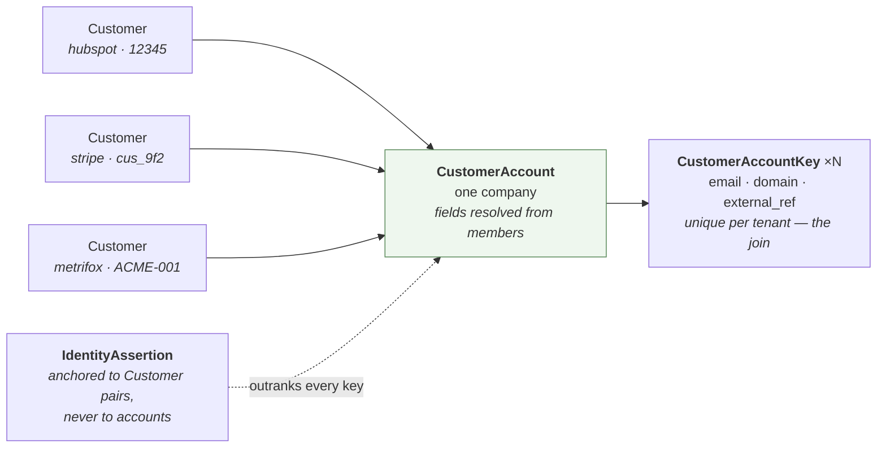
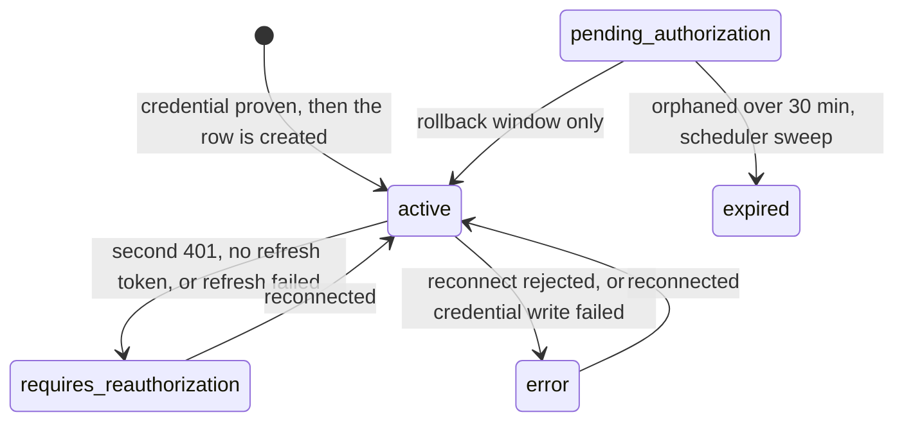

# Data model

Generated from [`prisma/schema.prisma`](../prisma/schema.prisma) and the
const-union types in [`src/core/types/common.ts`](../src/core/types/common.ts).
Fifteen tables in three groups:

- **The sync spine** — seven tables hanging off `Integration`, which is the
  tenancy boundary for everything a connector fetches.
- **The identity layer** — four tables scoped to `User` instead, because
  resolving one company across three connections is by definition not something
  any one `Integration` owns. Described under
  [The identity layer](#the-identity-layer-and-why-it-hangs-off-user).
- **Two scratch tables** holding a connect that has not finished yet, described
  under [Scratch tables](#scratch-tables-for-a-connect-in-progress).

> **Also available as an interactive page** —
> [`docs/diagrams/data-model.html`](./diagrams/data-model.html): the entity diagram
> with hover-to-isolate, a control that shows what a delete cascades through, and
> the status lifecycle. Open it in a browser; it needs no server.

---

## Entity relationships

```mermaid
erDiagram
    User ||--o{ Integration : "owns"
    User ||--o{ IntegrationDraft : "has configured, not yet connected"
    User ||--o{ CustomerAccount : "owns — identity is per tenant, not per connection"
    User ||--o{ IdentityResolutionRun : "audited by"

    Integration ||--o{ IntegrationFunction : "declares"
    Integration ||--o| OAuthToken : "authorized by"
    Integration ||--o{ FieldMapping : "configured by"
    Integration ||--o{ DiscoveredField : "caches source fields in"
    Integration ||--o{ Customer : "syncs"
    Integration ||--o{ Contact : "syncs"
    Integration ||--o{ SyncRun : "audited by"

    Customer |o--o{ Contact : "employs, link nullable"

    CustomerAccount |o--o{ Customer : "resolves, link nullable"
    CustomerAccount ||--o{ CustomerAccountKey : "matched by"
    Customer ||--o{ IdentityAssertion : "asserted about, twice per row"

    User {
        string id PK
        string email UK
        string passwordHash "scrypt, nullable — null cannot sign in"
        datetime createdAt
    }

    IntegrationDraft {
        string id PK "unguessable, not a UUID — it is the connect handle"
        string userId FK
        string providerName
        string functionNames "JSON array"
        string instanceLabel
        datetime expiresAt "30 minutes"
        datetime createdAt
    }

    OAuthState {
        string state PK "the value handed to the provider"
        string subjectKind "draft | integration"
        string subjectId "a draft id or an integration id — no FK, see below"
        datetime expiresAt "30 minutes"
        datetime createdAt
    }

    Integration {
        string id PK
        string userId FK
        string providerName "hubspot, salesforce, metrifox, stripe, mock"
        string status "IntegrationStatus, see state diagram"
        string instanceLabel "user-facing label"
        int syncIntervalHours "default 24, clamped 1..168"
        int identityPriority "default 100, clamped 1..1000 — values only, never grouping"
        datetime authorizationTimestamp "null until consent completes"
        datetime lastSyncTimestamp "null until first run"
        boolean pendingTokenRevocation "revocation failed on delete"
        datetime createdAt
        datetime updatedAt
    }

    IntegrationFunction {
        string id PK
        string integrationId FK
        string functionName "identity, support, billing, usage, communication"
        datetime addedAt
    }

    OAuthToken {
        string integrationId PK "also the FK, so at most one per integration"
        string accessTokenEnc "AES-256-GCM, never logged or returned"
        string refreshTokenEnc "null for non-refreshable grants"
        datetime expiresAt
        string grantedScopes "space-joined, what consent actually gave"
        string providerMetadata "JSON, Salesforce instance_url lives here"
        datetime updatedAt
    }

    FieldMapping {
        string id PK
        string integrationId FK
        string functionName "part of the mapping identity"
        string targetObject "customer, contact"
        string sourceFieldPath "dot path into the provider payload"
        string targetFieldPath "unqualified, e.g. domain"
        string transform "none, trim, lowercase, domainFromUrl, dateOnly"
        datetime createdAt
    }

    DiscoveredField {
        string id PK
        string integrationId FK
        string functionName
        string targetObject
        string path "provider field path"
        string label "provider display name"
        string type "provider-reported type"
        datetime fetchedAt
    }

    Customer {
        string id PK
        string integrationId FK
        string externalSourceId "provider-assigned, upsert key"
        string name
        string domain
        string email "a column, not a custom field — the resolver matches on it"
        string industry
        datetime createDate
        string type "CustomerType, nullable"
        string customFields "JSON object, max 50 keys"
        string crossRefs "JSON, provider to foreign id, from crossRef.* rules"
        string importedCrossRefs "JSON, same shape, human-supplied — see below"
        string customerAccountId FK "which company this row resolved to, nullable"
        datetime updatedAt
    }

    Contact {
        string id PK
        string integrationId FK
        string externalSourceId "provider-assigned, upsert key"
        string name
        string email
        string jobTitle
        string phone
        string customerId FK "resolved internal parent, nullable"
        string externalCustomerId "provider company id, pre-resolution"
        string customFields "JSON object"
        datetime updatedAt
    }

    SyncRun {
        string id PK
        string integrationId FK
        string status "SyncRunStatus"
        string trigger "manual, scheduled"
        datetime startedAt
        datetime completedAt "null while running"
        int customerCount
        int contactCount
        int attempt "default 1"
        string errorsJson "JSON array of RecordIssue"
    }

    CustomerAccount {
        string id PK "not stable — created, absorbed and reaped every pass"
        string userId FK
        string name "survivorship result, recomputed whole each pass"
        string domain
        string email
        string industry
        datetime createDate "earliest across members, not highest-priority"
        string type "CustomerType, nullable"
        string customFields "JSON, unioned across members"
        string fieldProvenance "JSON, field name to the integrationId that won it"
        datetime createdAt
        datetime updatedAt
    }

    CustomerAccountKey {
        string id PK
        string userId FK "denormalized — the unique below spans it"
        string customerAccountId FK
        string kind "IdentityKeyKind — array order is the strength ranking"
        string value "normalized; the thing actually matched on"
        string rawValue "as the provider gave it; what a human is shown"
        string emailClass "EmailClass — stored to explain, never to filter"
        string source "IdentityEvidenceSource"
        string sourceIntegrationId "which connection contributed it"
        datetime firstSeenAt
        datetime lastSeenAt
    }

    IdentityAssertion {
        string id PK
        string userId FK
        string kind "same or distinct"
        string leftCustomerId FK "canonically ordered: left lt right"
        string rightCustomerId FK
        string note "why, in the user's words"
        datetime createdAt
    }

    IdentityResolutionRun {
        string id PK
        string userId FK "per user, not per integration"
        string status "SyncRunStatus, reused verbatim"
        string trigger "IdentityRunTrigger: sync, scheduled, manual"
        datetime startedAt
        datetime completedAt "null while running"
        int accountsCreated
        int accountsAbsorbed
        int accountsReaped
        int customersLinked
        int keysIndexed "rows written, not keys offered"
        string issuesJson "JSON array of IdentityIssue"
    }
```

### Reading the spine

`Integration` is the tenancy boundary. Every synced record, mapping rule,
discovered field, and run carries `integrationId` — which is why deleting one
integration is a clean cascade, and why no query leaks another integration's
data by omission.

`User` sits above it only for ownership, and that ownership is enforced: every
request-scoped read of an integration goes through `findIntegrationForUser`,
which puts `userId` in the `where` clause. The unscoped `findIntegration`
survives for the scheduler, which sweeps every user and has none in scope.

As shipped there is still one seeded account (see
[Known limitations](../README.md#known-limitations)) — but it is a real one now,
authenticated by Auth.js against `passwordHash`.

Two relationships carry the design load:

- **`Integration` → `IntegrationFunction` is one-to-many, not one-to-one.** A
  single HubSpot connection can serve `identity` *and* `support`. The OAuth
  scopes requested are the union across these rows, which is why the function
  set has to be known before authorization.
- **`Customer` → `Contact` is optional on the contact side.** Providers hand
  back their *own* company id, never our UUID. Customers are written first to
  build an `external → internal` index; a contact whose company will not resolve
  is kept with `customerId = null` and its `externalCustomerId` retained, so a
  later sync links it once that company arrives.

---

## The identity layer, and why it hangs off `User`

Everything above is scoped by `Integration`. These four are not, and the reason
is the whole point of them: one real company appears as three `Customer` rows in
three connections, so the thing that says "these are one company" cannot belong
to any of the three.

Four things about this shape are load-bearing.

**`userId` is on every one of them, and the uniques lead with it.** This is the
severe failure mode in the whole schema: not a missed join, which is visible and
recoverable, but *one tenant's customers appearing under another's company*. A
single `where` clause missing `userId` does that silently. Hence
`@@unique([userId, kind, value])` on the key table — within one tenant a key
belongs to at most one account, so a second claim is a detectable conflict
rather than an overwrite — and hence the rule that every query in
[`identity-repository.ts`](../src/core/repositories/identity-repository.ts)
filters on it.

**`CustomerAccountKey` is a table, not a column.** The identity table is
`account → [keys]`, one-to-many, and `kind` is polymorphic. That is what lets a
Stripe customer id, an email and a domain all be the same sort of evidence with
different strengths — `IDENTITY_KEY_KINDS` array order *is* the ranking, which
is why it is an ordered const and not a set.

**`CustomerAccount` fields are derived, never authored.** Every column on it is
a pure function of (members, `Integration.identityPriority`), recomputed whole
on every pass, so it cannot drift from its members. `fieldProvenance` records
which integration won each field, which is what makes the per-field provider
chip on the Accounts tab renderable — and traceability is a stated requirement,
not a nicety.

**`IdentityAssertion` anchors to `Customer`, not to `CustomerAccount`.** Account
ids are created, absorbed and reaped by every pass, so they are not stable
anchors; a `Customer` row survives re-sync because the writer upserts it, and
cascades away with its integration. That is exactly the lifetime a human's
verdict should have. The pair is stored canonically ordered
(`leftCustomerId < rightCustomerId`) because without it `(A,B)` and `(B,A)` both
insert and the unique means nothing.

`Customer.customerAccountId` is `SetNull` rather than `Cascade` for the same
reason `Contact.customerId` is: reaping an empty account must not delete the
records that just left it.

### Two JSON columns that look redundant and are not

`Customer.crossRefs` and `Customer.importedCrossRefs` hold the same shape —
`{ provider: foreignId }` — and are deliberately separate. The record writer
**overwrites `crossRefs` wholesale on every upsert**, because it is the output
of the mapping rules and nothing else. A human-supplied pair kept there would
survive exactly until the next sync, taking its grouping with it. Keeping them
apart also lets a key record `imported_crosswalk` as its `source` rather than
claiming a mapping rule it never came from.

---

## Scratch tables for a connect in progress

`IntegrationDraft` and `OAuthState` are the two tables that are not user data.
Both are written by one request and read by a later one, both carry a 30-minute
`expiresAt`, and losing either costs the user a retry and nothing else.

- **`IntegrationDraft`** holds a provider and function set the user has chosen
  but not yet proven a credential for. It exists so that no `Integration` row is
  created until a credential is accepted — a rejected key leaves nothing behind.
  Consumed on success only, so a mistyped key can be re-pasted against the same
  draft.
- **`OAuthState`** holds an issued `state` value awaiting its callback, the CSRF
  defence for the authorization flow. Single-use, and the delete *is* the read:
  two concurrent callbacks bearing one state race on one row and exactly one
  wins.

Both were `Map`s on `globalThis` until they were not. Being written by `/start`
and read by `/callback` — or written by the create call and read by the connect
page — means an in-process store is invisible to every request but the one that
wrote it as soon as a second instance exists, which is how they failed on a
serverless host: every callback rejected, every draft "expired" on arrival.

`OAuthState.subjectId` deliberately has no foreign key, because it names a row
in one of two tables depending on `subjectKind`. Reading it back treats anything
other than `"draft"` as an integration, which is the branch that fails safely: it
looks for an integration that will not be found, rather than building one out of
a draft id.

---

## Referential actions

| Parent | Child | On parent delete |
|---|---|---|
| `User` | `Integration`, `IntegrationDraft`, `CustomerAccount`, `IdentityResolutionRun` | `Cascade` |
| `Integration` | `IntegrationFunction`, `OAuthToken`, `FieldMapping`, `DiscoveredField`, `Customer`, `Contact`, `SyncRun` | `Cascade` |
| `Customer` | `Contact` | `SetNull` — the contact survives, unlinked |
| `Customer` | `IdentityAssertion` (both sides) | `Cascade` — a verdict about a row that no longer exists is not a verdict |
| `CustomerAccount` | `CustomerAccountKey` | `Cascade` |
| `CustomerAccount` | `Customer` | `SetNull` — the customer survives, unresolved |

`Customer` → `Contact` is deliberately not a cascade: losing a company record
should not silently delete the people attached to it. `CustomerAccount` →
`Customer` is `SetNull` for the sharper version of the same reason — accounts
are reaped routinely, and a cascade there would delete synced records as a side
effect of housekeeping.

The `CustomerAccount` → `CustomerAccountKey` cascade is what makes reaping
correct rather than merely tidy. An empty account still holding a key claim
would permanently block the right account from ever forming, because the unique
means that key can only belong to one.

---

## Uniqueness — where identity actually lives

| Table | Constraint | Why |
|---|---|---|
| `User` | `email` | The stable handle the demo looks the user up by. |
| `Customer` | `(integrationId, externalSourceId)` | The upsert key. Re-running a sync updates rather than duplicates. |
| `Contact` | `(integrationId, externalSourceId)` | Same. |
| `IntegrationFunction` | `(integrationId, functionName)` | A function is declared once per integration. |
| `FieldMapping` | `(integrationId, functionName, targetObject, targetFieldPath)` | One rule per target field. Function and target object are part of the identity, because two functions on one integration can write to the same object. |
| `DiscoveredField` | `(integrationId, functionName, targetObject, path)` | Cache key. |
| `OAuthToken` | `integrationId` as the primary key | Structurally at most one live token per integration. |
| `CustomerAccountKey` | `(userId, kind, value)` | **This one is the join.** Within a tenant a key belongs to at most one account, so a second claim is a detectable conflict rather than a silent overwrite — and it is the concurrency backstop two passes race on. `userId` is denormalized into the row because Prisma cannot express a unique spanning a relation, the same reason `OAuthState` keeps `subjectKind`/`subjectId` flat. |
| `IdentityAssertion` | `(leftCustomerId, rightCustomerId)` | One verdict per pair. Only meaningful because the pair is stored canonically ordered; without that, asserting `(B,A)` after `(A,B)` would insert a second row instead of conflicting. |

Indexes beyond those: `Integration(userId)` and `Integration(status)` for the
scheduler sweep, `FieldMapping(integrationId)` and
`(integrationId, functionName)`, `Customer(integrationId)`,
`Contact(integrationId)` and `Contact(customerId)`,
`SyncRun(integrationId, startedAt)` for run-history ordering, and
`IntegrationFunction(functionName)`. The identity layer adds
`Customer(customerAccountId)` for member lookups, `CustomerAccount(userId)` and
`(userId, name)` for the Accounts tab's `name asc, id asc` ordering,
`CustomerAccountKey(customerAccountId)`, `IdentityAssertion(userId)`, and
`IdentityResolutionRun(userId, startedAt)` for run history. The scratch tables
add `IntegrationDraft(userId)`, `OAuthState(subjectKind, subjectId)` for the two
discard-by-subject paths, and `expiresAt` on both, which is what the sweep on
each write path scans.

---

## Columns that are strings but are not really strings

Both are modelled as `String` and constrained in application code. The reason
is historical: the tests used to run on SQLite, where Prisma supports neither
`enum` nor `Json`, so avoiding both was what let one schema serve SQLite
locally and Postgres in deployment.

Everything now runs Postgres, which supports both, so that constraint is gone
and promoting these columns to native `enum` / `jsonb` is available. It is a
data migration plus a sweep through the repositories and the type layer rather
than a schema edit, so it has not been done here — the guards below are still
the source of truth.

### Enum-shaped

| Column | Legal values | Guard |
|---|---|---|
| `Integration.status` | `pending_authorization`, `active`, `expired`, `requires_reauthorization`, `error` | `isIntegrationStatus` |
| `Customer.type`, `CustomerAccount.type` | `prospect`, `customer`, `partner`, `vendor`, or null | `isCustomerType` |
| `FieldMapping.targetObject` | `customer`, `contact` | `isTargetObject` |
| `SyncRun.status`, `IdentityResolutionRun.status` | `running`, `success`, `partial`, `failed`, `discarded` | `isSyncRunStatus` |
| `FieldMapping.transform` | `none`, `trim`, `lowercase`, `domainFromUrl`, `dateOnly` | [`transforms.ts`](../src/core/field-mapper/transforms.ts) |
| `CustomerAccountKey.kind` | `external_ref`, `email`, `domain` | `isIdentityKeyKind` |
| `CustomerAccountKey.emailClass` | `corporate`, `role`, `freemail` | `isEmailClass` |
| `CustomerAccountKey.source` | `customer_email`, `customer_domain`, `customer_custom_field`, `contact_email`, `self_reference`, `mapped_cross_ref`, `imported_crosswalk` | `isIdentityEvidenceSource` |
| `IdentityAssertion.kind` | `same`, `distinct` | `isIdentityAssertionKind` |
| `IdentityResolutionRun.trigger` | `sync`, `scheduled`, `manual` | `isIdentityRunTrigger` |

Two of those carry meaning beyond validity. **`IDENTITY_KEY_KINDS` is ordered,
and the order is the strength ranking** — `external_ref` beats `email` beats
`domain` — which is why it is a const array and not a set. And
`IdentityResolutionRun` reuses `SyncRunStatus` verbatim rather than declaring
its own: the five states mean the same things, down to `discarded` being what
the concurrency guard produces.

`emailClass` is stored to **explain** a key, never to filter one. Role addresses
like `billing@` and `accounts@` are still keys — the spec's own seeds are
billing emails — so classifying one is a fact shown to a human adjudicating a
match, not a gate.

Each guard lives beside its union in
[`src/core/types/common.ts`](../src/core/types/common.ts), so the type and its
runtime check cannot drift.

### JSON-shaped

Read and written only through
[`json-column.ts`](../src/core/repositories/json-column.ts).

| Column | Default | Shape |
|---|---|---|
| `Customer.customFields` | `{}` | `Record<string, unknown>`, max 50 keys |
| `Customer.crossRefs` | `{}` | `Record<provider, foreignId>` from `crossRef.<provider>` mapping rules. **Overwritten wholesale on every upsert** |
| `Customer.importedCrossRefs` | `{}` | Same shape, human-supplied. Separate precisely because the line above is true |
| `Contact.customFields` | `{}` | `Record<string, unknown>` |
| `CustomerAccount.customFields` | `{}` | Unioned across members, higher priority winning a shared key |
| `CustomerAccount.fieldProvenance` | `{}` | `Record<fieldName, integrationId>` — which source won each field |
| `OAuthToken.providerMetadata` | `{}` | Provider extras from the token response, e.g. Salesforce `instance_url` and `organizationId` |
| `SyncRun.errorsJson` | `[]` | `RecordIssue[]` — `{ sourceRecordId, targetObject, reason, fieldName?, severity }` |
| `IdentityResolutionRun.issuesJson` | `[]` | `IdentityIssue[]` — a **discriminated union** on `kind`, not one shape with eight optional fields, so a renderer cannot read `fieldName` off a key conflict |
| `IntegrationDraft.functionNames` | none | `string[]` — the function names chosen, deduped and sorted before storage |

The four `IdentityIssue` kinds are `key_claimed_elsewhere` (two accounts claim
one key; never auto-merged, a human decides), `blocked_by_assertion` (a
`distinct` verdict refused a grouping some key would have made), `field_conflict`
(equal-priority sources disagree on a value) and `key_race_lost` (a concurrent
pass inserted the same key first).

---

## `Integration.status` lifecycle

The one column with real behaviour behind it. Every write goes through
`updateStatus` or `markAuthorized` in
[`integration-repository.ts`](../src/core/repositories/integration-repository.ts).

**`pending_authorization` is nearly unreachable, and that is the point.** A row
used to be inserted as soon as the user picked a provider, which meant every
failed or abandoned connect left one behind to be deleted by hand. The
configuration is now held as a draft
([`draft-store.ts`](../src/core/integrations/draft-store.ts)) and the row is
created only once a credential is proven, so an integration is `active` from the
moment it exists. The only way to observe `pending_authorization` is a crash
inside `createIntegrationFromDraft`, between the insert and `markAuthorized`,
where the compensating delete also failed to run — which is what the scheduler
sweep still exists to retire.

A failed *reconnect* is the deliberate exception: it sets `error` and keeps the
row, because an established integration may hold edited mappings and synced
records.

Only `active` integrations sync. The scheduler
([`scheduler.ts`](../src/core/sync/scheduler.ts)) skips everything else, and
`POST /api/integrations/[id]/sync`, the fields route, and the mapping page each
gate on it independently rather than trusting the caller.

`expired` is narrower than it sounds: it means *abandoned before authorization
ever completed*, not *token past `expiresAt`*. An expired access token on a live
integration is a refresh attempt; only a **failed** refresh moves the
integration, and it moves to `requires_reauthorization`.
