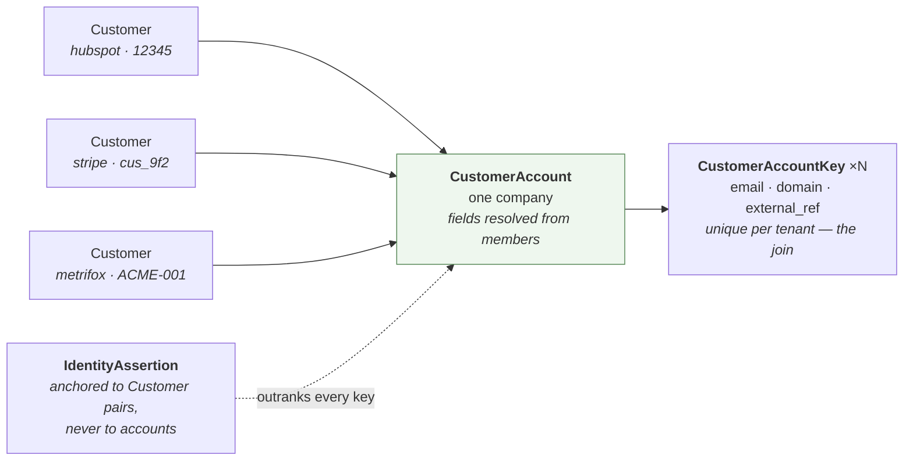
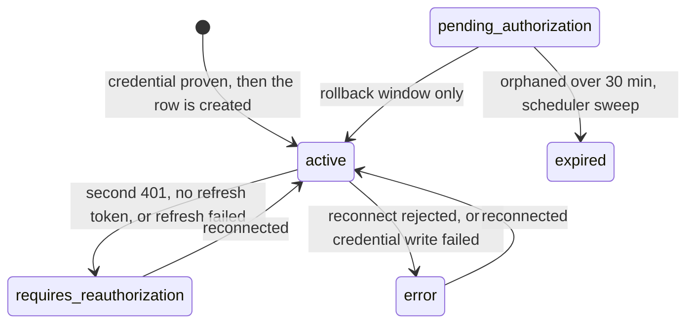

# Data model

Generated from [`prisma/schema.prisma`](../prisma/schema.prisma) and the
const-union types in [`src/core/types/common.ts`](../src/core/types/common.ts).
Twenty-eight tables in three groups:

- **The sync spine** — twenty tables hanging off `Integration`, which is the
  tenancy boundary for everything a connector fetches. It now spans four
  functions: identity, catalog, agreement and billing.
- **The identity layer** — four tables scoped to `User` instead, because
  resolving one company across three connections is by definition not something
  any one `Integration` owns. Described under
  [The identity layer](#the-identity-layer-and-why-it-hangs-off-user).
- **Two scratch tables** holding a connect that has not finished yet, described
  under [Scratch tables](#scratch-tables-for-a-connect-in-progress).

Plus `User` itself, which sits above the spine for ownership only.

> **Also available as an interactive page** —
> [`docs/diagrams/data-model.html`](./diagrams/data-model.html): the entity diagram
> with hover-to-isolate, a control that shows what a delete cascades through, and
> the status lifecycle. Open it in a browser; it needs no server.

---

## Entity relationships

```mermaid
erDiagram
    User ||--o{ Integration : "owns"
    User ||--o{ IntegrationDraft : "has configured, not yet connected"
    User ||--o{ CustomerAccount : "owns — identity is per tenant, not per connection"
    User ||--o{ IdentityResolutionRun : "audited by"

    Integration ||--o{ IntegrationFunction : "declares"
    Integration ||--o| OAuthToken : "authorized by"
    Integration ||--o{ FieldMapping : "configured by"
    Integration ||--o{ DiscoveredField : "caches source fields in"
    Integration ||--o{ Customer : "syncs"
    Integration ||--o{ Contact : "syncs"
    Integration ||--o{ Product : "syncs"
    Integration ||--o{ Offering : "syncs"
    Integration ||--o{ Price : "syncs"
    Integration ||--o{ Feature : "syncs"
    Integration ||--o{ Entitlement : "syncs"
    Integration ||--o{ Agreement : "syncs"
    Integration ||--o{ Subscription : "syncs"
    Integration ||--o{ AgreementItem : "syncs"
    Integration ||--o{ AgreementEntitlement : "syncs"
    Integration ||--o{ AgreementDiscount : "syncs"
    Integration ||--o{ Invoice : "syncs"
    Integration ||--o{ InvoiceLine : "syncs"
    Integration ||--o{ Payment : "syncs"
    Integration ||--o{ SyncRun : "audited by"

    Customer |o--o{ Contact : "employs, link nullable"

    Product |o--o{ Offering : "priced by, link nullable"
    Offering |o--o{ Price : "priced by, link nullable"
    Offering |o--o{ Entitlement : "includes, link nullable"
    Feature |o--o{ Entitlement : "granted by, link nullable"

    Customer |o--o{ Agreement : "agreed to, link nullable"
    Offering |o--o{ Agreement : "sold under, link nullable"
    Agreement ||--o| Subscription : "detailed by, required and unique"
    Agreement ||--o{ AgreementItem : "itemized by, required and cascade"
    Agreement ||--o{ AgreementEntitlement : "confers, required and cascade"
    Agreement ||--o{ AgreementDiscount : "discounted by, required and cascade"
    Feature |o--o{ AgreementEntitlement : "granted by, link nullable"
    Price |o--o{ AgreementItem : "billed at, link nullable"
    Offering |o--o{ AgreementItem : "billed for, link nullable"

    Customer |o--o{ Invoice : "billed, link nullable"
    Agreement |o--o{ Invoice : "bills, link nullable"
    Invoice ||--o{ InvoiceLine : "itemized by, required and cascade"
    Invoice |o--o{ Payment : "settled by, link nullable"
    Customer |o--o{ Payment : "pays, link nullable"
    Price |o--o{ InvoiceLine : "billed at, link nullable"
    Offering |o--o{ InvoiceLine : "billed for, link nullable"

    CustomerAccount |o--o{ Customer : "resolves, link nullable"
    CustomerAccount ||--o{ CustomerAccountKey : "matched by"
    Customer ||--o{ IdentityAssertion : "asserted about, twice per row"

    User {
        string id PK
        string email UK
        string passwordHash "scrypt, nullable — null cannot sign in"
        datetime createdAt
    }

    IntegrationDraft {
        string id PK "unguessable, not a UUID — it is the connect handle"
        string userId FK
        string providerName
        string functionNames "JSON array"
        string instanceLabel
        datetime expiresAt "30 minutes"
        datetime createdAt
    }

    OAuthState {
        string state PK "the value handed to the provider"
        string subjectKind "draft | integration"
        string subjectId "a draft id or an integration id — no FK, see below"
        datetime expiresAt "30 minutes"
        datetime createdAt
    }

    Integration {
        string id PK
        string userId FK
        string providerName "hubspot, salesforce, metrifox, stripe, chargebee, mock"
        string status "IntegrationStatus, see state diagram"
        string instanceLabel "user-facing label"
        int syncIntervalHours "default 24, clamped 1..168"
        int identityPriority "default 100, clamped 1..1000 — values only, never grouping"
        datetime authorizationTimestamp "null until consent completes"
        datetime lastSyncTimestamp "null until first run"
        boolean pendingTokenRevocation "revocation failed on delete"
        datetime createdAt
        datetime updatedAt
    }

    IntegrationFunction {
        string id PK
        string integrationId FK
        string functionName "identity, catalog, agreement, billing, support, usage, communication"
        datetime addedAt
    }

    OAuthToken {
        string integrationId PK "also the FK, so at most one per integration"
        string accessTokenEnc "AES-256-GCM, never logged or returned"
        string refreshTokenEnc "null for non-refreshable grants"
        datetime expiresAt
        string grantedScopes "space-joined, what consent actually gave"
        string providerMetadata "JSON, Salesforce instance_url lives here"
        datetime updatedAt
    }

    FieldMapping {
        string id PK
        string integrationId FK
        string functionName "part of the mapping identity"
        string targetObject "customer … payment — see TARGET_OBJECTS"
        string sourceFieldPath "dot path into the provider payload"
        string targetFieldPath "unqualified, e.g. domain"
        string transform "none, trim, lowercase, domainFromUrl, dateOnly"
        datetime createdAt
    }

    DiscoveredField {
        string id PK
        string integrationId FK
        string functionName
        string targetObject
        string path "provider field path"
        string label "provider display name"
        string type "provider-reported type"
        datetime fetchedAt
    }

    Customer {
        string id PK
        string integrationId FK
        string externalSourceId "provider-assigned, upsert key"
        string name
        string domain
        string email "a column, not a custom field — the resolver matches on it"
        string industry
        datetime createDate
        string type "CustomerType, nullable"
        string customFields "JSON object, max 50 keys"
        string crossRefs "JSON, provider to foreign id, from crossRef.* rules"
        string importedCrossRefs "JSON, same shape, human-supplied — see below"
        string customerAccountId FK "which company this row resolved to, nullable"
        datetime updatedAt
    }

    Contact {
        string id PK
        string integrationId FK
        string externalSourceId "provider-assigned, upsert key"
        string name
        string email
        string jobTitle
        string phone
        string customerId FK "resolved internal parent, nullable"
        string externalCustomerId "provider company id, pre-resolution"
        string customFields "JSON object"
        datetime updatedAt
    }

    Product {
        string id PK
        string integrationId FK
        string externalSourceId "provider-assigned, upsert key"
        string name
        string description
        boolean active "nullable — null is 'not told', not 'inactive'"
        string customFields "JSON object"
        datetime updatedAt
    }

    Offering {
        string id PK
        string integrationId FK
        string externalSourceId "provider-assigned, upsert key"
        string name "required; synthesized when the provider has none"
        string description
        string productId FK "resolved internal parent, nullable"
        string externalProductId "provider product id, pre-resolution"
        boolean active "nullable — null is 'not told', not 'inactive'"
        string customFields "JSON object"
        datetime updatedAt
    }

    Price {
        string id PK
        string integrationId FK
        string externalSourceId "provider-assigned, upsert key"
        string name "required; synthesized when the provider has none"
        string offeringId FK "resolved internal parent, nullable"
        string externalOfferingId "provider offering id, pre-resolution"
        int amountMinor "minor units — never a float"
        string currency "ISO 4217"
        string interval "BillingInterval: day|week|month|year|one_time"
        int intervalCount
        boolean active
        string customFields "JSON object"
        datetime updatedAt
    }

    Feature {
        string id PK
        string integrationId FK
        string externalSourceId "the *definition* id (feat_…), upsert key"
        string name "required"
        string lookupKey "the stable key code gates on — indexed"
        boolean isMetered "Chargebee's metered; null on Stripe, which has no such concept"
        string unit "what a metered grant counts — Chargebee's unit"
        string customFields "JSON object"
        datetime updatedAt
    }

    Entitlement {
        string id PK
        string integrationId FK
        string externalSourceId "the *attachment* id (prodft_…), not the feature id"
        string featureId FK "resolved internal parent, nullable"
        string externalFeatureId "shared across rows when one feature is attached twice"
        string offeringId FK "resolved internal parent, nullable"
        string externalOfferingId "from the request URL, not the payload"
        string value "the provider's answer verbatim"
        string valueName "Chargebee's entitlement level label"
        int limitValue "the numeric form of value; null means no stated limit"
        string customFields "JSON object"
        datetime updatedAt
    }

    Agreement {
        string id PK
        string integrationId FK
        string externalSourceId "provider-assigned, upsert key"
        string name "required; synthesized — Stripe names no subscription"
        string agreementType "AgreementType, NOT NULL — which detail table joins"
        string status "AgreementStatus, nullable"
        string customerId FK "resolved internal parent, nullable"
        string externalCustomerId "provider customer id, pre-resolution"
        string offeringId FK "resolved internal parent, nullable"
        string externalOfferingId "provider price id, pre-resolution"
        datetime effectiveDate
        datetime endDate
        string currency
        string customFields "JSON object"
        string providerMetadata "the raw provider bag — meta_data, metadata"
        datetime updatedAt
    }

    Subscription {
        string id PK
        string integrationId FK
        string externalSourceId "same provider id as its Agreement"
        string agreementId FK "required and unique — Cascade, not SetNull"
        datetime currentPeriodStart
        datetime currentPeriodEnd
        datetime trialStartsAt
        datetime trialEndsAt
        datetime canceledAt "when cancellation was requested"
        datetime cancelAt "when the provider says it stops — Chargebee's cancel_at"
        boolean cancelAtPeriodEnd
        datetime nextBillingAt "what renews next; the read model sorts on it"
        string billingPeriod "SubscriptionBillingPeriod — the *primary* line's cadence"
        int billingPeriodCount "how many billingPeriods make one cycle"
        string collectionMethod "CollectionMethod: automatic|manual|none"
        int quantity
        int itemCount "priced lines; only the first is linked"
        string customFields "JSON object"
        string providerMetadata "the raw provider bag"
        datetime updatedAt
    }

    AgreementItem {
        string id PK
        string integrationId FK
        string externalSourceId "provider-assigned, upsert key — what reconciliation compares"
        string agreementId FK "required and cascade — both rows off one payload"
        string priceId FK "resolved internal parent, nullable"
        string externalPriceId
        string offeringId FK "resolved internal parent, nullable"
        string externalOfferingId
        int quantity
        int position "the provider's own ordering — not a rank"
        string itemType "AgreementItemType, nullable — not InvoiceLineType"
        string billingModel "BillingModel, nullable — flat_fee|per_unit|tiered|usage_based|one_time"
        int unitPriceMinor "per-unit price *for this subscription*; Chargebee only"
        int freeQuantity "units included at no charge — Chargebee's free_quantity"
        int billingCycles "how many cycles this line runs for"
        string customFields "JSON object"
        string providerMetadata "the raw provider bag"
        datetime updatedAt
    }

    AgreementEntitlement {
        string id PK
        string integrationId FK
        string externalSourceId "synthesized as subscriptionId:featureId on Chargebee"
        string agreementId FK "required and cascade — both rows off one payload"
        string featureId FK "resolved internal parent, nullable"
        string externalFeatureId
        string value "the provider's answer verbatim"
        string valueName "the entitlement's level label"
        int limitValue "the numeric form of value; null means no stated limit"
        boolean isOverride "overrides the catalog baseline rather than inheriting it"
        boolean isEnabled "the feature is granted at all — so an absent one is not read as zero"
        string customFields "JSON object"
        string providerMetadata "the raw provider bag"
        datetime updatedAt
    }

    AgreementDiscount {
        string id PK
        string integrationId FK
        string externalSourceId "the discount/attachment id — what reconciliation compares"
        string agreementId FK "required and cascade — both rows off one payload"
        string externalCouponId "the coupon it came from; no relation, no coupon table"
        string label
        string kind "DiscountKind: percentage|fixed_amount|free_items"
        int percentOff "whole percent, as stated"
        int amountOffMinor "the currency's minor unit, as stated"
        string status "DiscountStatus: active|expired|removed|scheduled"
        datetime startsAt
        datetime endsAt
        string customFields "JSON object"
        string providerMetadata "the raw provider bag"
        datetime updatedAt
    }

    Invoice {
        string id PK
        string integrationId FK
        string externalSourceId "provider-assigned, upsert key"
        string number "human invoice number; Chargebee's id, Stripe's number"
        string status "InvoiceStatus, nullable"
        string customerId FK "resolved internal parent, nullable"
        string externalCustomerId "provider customer id, pre-resolution"
        string agreementId FK "resolved internal parent, nullable"
        string externalAgreementId "provider subscription id, pre-resolution"
        string currency
        int subtotalMinor "the sum the provider states of its lines"
        int discountMinor "null on Stripe — it states an array; Chargebee states none"
        int taxMinor "null on Stripe — it states an array; Chargebee states one"
        int totalMinor "stated by the provider, never computed from the lines"
        int amountDueMinor "stated, never computed"
        int amountPaidMinor "stated, never summed from Payment"
        datetime issuedAt "Stripe finalized_at, Chargebee generated_at"
        datetime dueAt
        datetime periodStart "Stripe only"
        datetime periodEnd "Stripe only"
        datetime paidAt
        string hostedUrl "Stripe only"
        string customFields "JSON object"
        string providerMetadata "Chargebee writes subscription_id: consolidated here"
        datetime updatedAt
    }

    InvoiceLine {
        string id PK
        string integrationId FK
        string externalSourceId "provider-assigned, upsert key"
        string invoiceId FK "required and cascade — both rows off one payload"
        string description
        int quantity
        int unitAmountMinor "the billed unit price; nullable when fractional"
        int amountMinor "the billed line total"
        datetime periodStart
        datetime periodEnd
        boolean isProration "Stripe only"
        string itemType "InvoiceLineType, nullable — not AgreementItemType"
        string priceId FK "resolved internal parent, nullable"
        string externalPriceId
        string offeringId FK "resolved internal parent, nullable"
        string externalOfferingId
        string customFields "JSON object"
        string providerMetadata "the raw provider bag"
        datetime updatedAt
    }

    Payment {
        string id PK
        string integrationId FK
        string externalSourceId "provider-assigned, upsert key"
        string invoiceId FK "resolved internal parent, nullable"
        string externalInvoiceId "provider invoice id, pre-resolution"
        string customerId FK "resolved internal parent, nullable"
        string externalCustomerId "provider customer id, pre-resolution"
        string kind "PaymentKind, NOT NULL — payment or refund"
        string status "PaymentStatus, nullable"
        int amountMinor
        string currency
        datetime processedAt "Stripe created, Chargebee settled_at"
        string method "free text — Stripe ships ~90 values and adds more"
        string failureReason
        boolean isDisputed
        string providerReference "the provider's own id, kept beside ours"
        string customFields "JSON object"
        string providerMetadata "the raw provider bag"
        datetime updatedAt
    }

    SyncRun {
        string id PK
        string integrationId FK
        string status "SyncRunStatus"
        string trigger "manual, scheduled"
        datetime startedAt
        datetime completedAt "null while running"
        string recordCountsJson "rows written per target object — a map, not two count columns"
        int attempt "default 1"
        string errorsJson "JSON array of RecordIssue"
    }

    CustomerAccount {
        string id PK "not stable — created, absorbed and reaped every pass"
        string userId FK
        string name "survivorship result, recomputed whole each pass"
        string domain
        string email
        string industry
        datetime createDate "earliest across members, not highest-priority"
        string type "CustomerType, nullable"
        string customFields "JSON, unioned across members"
        string fieldProvenance "JSON, field name to the integrationId that won it"
        datetime createdAt
        datetime updatedAt
    }

    CustomerAccountKey {
        string id PK
        string userId FK "denormalized — the unique below spans it"
        string customerAccountId FK
        string kind "IdentityKeyKind — array order is the strength ranking"
        string value "normalized; the thing actually matched on"
        string rawValue "as the provider gave it; what a human is shown"
        string emailClass "EmailClass — stored to explain, never to filter"
        string source "IdentityEvidenceSource"
        string sourceIntegrationId "which connection contributed it"
        datetime firstSeenAt
        datetime lastSeenAt
    }

    IdentityAssertion {
        string id PK
        string userId FK
        string kind "same or distinct"
        string leftCustomerId FK "canonically ordered: left lt right"
        string rightCustomerId FK
        string note "why, in the user's words"
        datetime createdAt
    }

    IdentityResolutionRun {
        string id PK
        string userId FK "per user, not per integration"
        string status "SyncRunStatus, reused verbatim"
        string trigger "IdentityRunTrigger: sync, scheduled, manual"
        datetime startedAt
        datetime completedAt "null while running"
        int accountsCreated
        int accountsAbsorbed
        int accountsReaped
        int customersLinked
        int keysIndexed "rows written, not keys offered"
        string issuesJson "JSON array of IdentityIssue"
    }
```

### Reading the spine

`Integration` is the tenancy boundary. Every synced record, mapping rule,
discovered field, and run carries `integrationId` — which is why deleting one
integration is a clean cascade, and why no query leaks another integration's
data by omission.

`User` sits above it only for ownership, and that ownership is enforced: every
request-scoped read of an integration goes through `findIntegrationForUser`,
which puts `userId` in the `where` clause. The unscoped `findIntegration`
survives for the scheduler, which sweeps every user and has none in scope.

As shipped there is still one seeded account (see
[Known limitations](../README.md#known-limitations)) — but it is a real one now,
authenticated by Auth.js against `passwordHash`.

Two relationships carry the design load:

- **`Integration` → `IntegrationFunction` is one-to-many, not one-to-one.** A
  single HubSpot connection can serve `identity` *and* `support`; a single Stripe
  connection can serve all three commercial functions. The scopes requested are
  the union across these rows, which is why the function set has to be known
  before authorization.
- **`Customer` → `Contact` is optional on the contact side.** Providers hand
  back their *own* company id, never our UUID. Customers are written first to
  build an `external → internal` index; a contact whose company will not resolve
  is kept with `customerId = null` and its `externalCustomerId` retained, so a
  later sync links it once that company arrives.

That second rule generalizes across the spine, and the exceptions to it are
enumerated under [Referential actions](#referential-actions): every parent-child
edge either keeps the provider's id for a later relink or is an extension whose
rows always arrive together.

---

## `Feature` and `Entitlement`: a definition, and the links to it

Two tables where there used to be one, and the split is the whole design. The
previous shape denormalized the feature's `name` and `lookup_key` onto every
attachment, so one feature on three offerings was three rows that had to be
grouped by a query. Now:

| | Table | Holds | Stripe | Chargebee |
|---|---|---|---|---|
| The definition | `Feature` | a reusable capability — name, `lookupKey`, `isMetered`, `unit` | `EntitlementFeature` (`feat_…`) | `Feature` |
| The link | `Entitlement` | *this* offering includes *that* feature, at this limit | `ProductFeature` (`prodft_…`) | `item_entitlement` |

Stripe names the pair the other way round, which is why each handler states
which of its objects is which. Chargebee was what made the split necessary rather
than tidy: its features carry `metered` and `unit`, and its attachments carry
`value`/`limit`, so a single flattened row would have had to hold a fact that
belongs to the definition and two that belong to the link, with no way to tell
which was which.

The upsert keys make the difference concrete. `Feature` is keyed on `feat_…` —
so a feature attached to two products is **one row**, and the handler enforces
that with a `seenFeatureIds` set across the whole run. `Entitlement` is keyed on
`prodft_…` — so the same feature attached to two products is **two rows**,
because two attachments really are two facts about two offerings.

### What each level can and cannot be read for

The two overlap by construction and **must never be summed**. `Entitlement` is
the catalog baseline — "the Pro offering includes 50 seats".
`AgreementEntitlement` is the per-agreement answer — what this subscriber
actually gets, with Chargebee's inherited values and per-subscription overrides
already folded in. `isOverride` is the only place the difference is visible, and
`isEnabled` is what stops a feature the customer does *not* have from reading as
a limit of zero.

`Feature` is the one root record on the commercial side: it hangs off nothing, so
`externalRefsOf` returns `{}` for it. `Entitlement` is the opposite — it names
two parents and neither is primary, so both resolve independently and a
half-linked row says which half.

### Two things about the parent link

**The offering id does not come from the payload.** A `ProductFeature` response
carries no `product` field at all; the id comes from the URL the handler just
requested. This is the only association in the system built that way, and it is
the only one whose failure is silent — every other parent id is read from the
record, so a wrong one produces a null or an unresolved warning. A handler that
lost track here would link every row to the wrong offering and report success.
`tests/unit/stripe-product-feature.test.ts` pins that the injected id wins even
over a `product` key on the record.

It is safe to inject precisely because **each Stripe product has one synthesized
offering carrying the same id**, which is why the handler can use one value for
both roles. A provider that had real item objects would not have that.

**There is no relink pass, deliberately.** `Offering` keeps
`externalProductId` *and* a `relinkOrphanedOfferings` pass, because a price can
arrive before its product. An entitlement cannot: the handler builds its URL from
a product it listed moments earlier in the same run. So an unresolved parent here
does not mean "not yet synced" — it means that parent was *rejected*, which no
later run repairs on its own. The column is still stored, for the warning and the
data browser, and `db:check` reports the count as expected-zero rather than
expected-small.

**Entitlements do not reconcile, so a detached feature persists.** There is no
absence detection on this pass, and no equivalent of the `status=all` parameter
that makes canceled subscriptions visible to a handler. A feature detached in
Stripe stays in our tables until the integration is deleted. That is a known gap
rather than a bug, and the same one every other upsert-only object in the schema
carries.

**What the split still cannot see: a feature attached to nothing.** Definitions
are read *off* attachments, so `feat_unattached` in the sandbox appears nowhere —
which is what makes it a checked claim rather than a remembered one.
`fixtures:verify` asserts it. Listing `/v1/entitlements/features` directly would
change that, and the handler deliberately probes it with `limit=1` only to decide
whether the per-product fan-out is worth running at all.

**Entitlements are offering-scoped, not price-scoped.** There is no
`/v1/prices/{id}/features` — the endpoint does not exist — so all prices on
Platform grant identical features, and the route from a price to its features is
`Price → Offering → Entitlement`. That is why nothing links a price to a feature
directly.

## The agreement's own children

`Agreement` is a shared commercial node, and four tables hang off it. Each one
earns its place rather than being a column on the parent:

| Table | Grain | The argument for it |
|---|---|---|
| `Subscription` | one per agreement, `@unique` | period, trial, cancellation. The sole detail row of a `subscription`-type agreement. |
| `AgreementItem` | many | *line items are not a subscription quirk.* Salesforce has `ContractLineItem`, `OrderItem` and `QuoteLineItem`; HubSpot models what a deal sold as line items; an order form is a header plus its lines. A subscription is the odd case where one offering link almost suffices — which is why this table was missing for so long. |
| `AgreementEntitlement` | many | what this subscriber *actually* gets, as distinct from the catalog baseline |
| `AgreementDiscount` | many | stated values only. No computed net, no post-discount total, no amount on the agreement to reconcile against |

`AgreementItem` is the only one of the four that deliberately carries **no amount
column**: a line is a *selection*, and what it bills for is the Offering or Price
it points at, which already holds the money. A subscription's true total is the
provider's to state, not ours to sum. `InvoiceLine` is the opposite case and does
carry two, because an invoice line *is* the money.

`AgreementDiscount` is allowed to carry `amountOffMinor` despite that, because a
discount's value *is* its amount — there is nothing to defer to.

`Agreement.providerMetadata` and the same column on its three children hold the
raw provider bag (`meta_data`, `metadata`). The name matches
`OAuthToken.providerMetadata` deliberately and means something different: there
it is token-response extras every later API call needs, here it is the
provider's own key/values we did not model.

## The identity layer, and why it hangs off `User`

Everything above is scoped by `Integration`. These four are not, and the reason
is the whole point of them: one real company appears as three `Customer` rows in
three connections, so the thing that says "these are one company" cannot belong
to any of the three.



Four things about this shape are load-bearing.

**`userId` is on every one of them, and the uniques lead with it.** This is the
severe failure mode in the whole schema: not a missed join, which is visible and
recoverable, but *one tenant's customers appearing under another's company*. A
single `where` clause missing `userId` does that silently. Hence
`@@unique([userId, kind, value])` on the key table — within one tenant a key
belongs to at most one account, so a second claim is a detectable conflict
rather than an overwrite — and hence the rule that every query in
[`identity-repository.ts`](../src/core/repositories/identity-repository.ts)
filters on it.

**`CustomerAccountKey` is a table, not a column.** The identity table is
`account → [keys]`, one-to-many, and `kind` is polymorphic. That is what lets a
Stripe customer id, an email and a domain all be the same sort of evidence with
different strengths — `IDENTITY_KEY_KINDS` array order *is* the ranking, which
is why it is an ordered const and not a set.

**`CustomerAccount` fields are derived, never authored.** Every column on it is
a pure function of (members, `Integration.identityPriority`), recomputed whole
on every pass, so it cannot drift from its members. `fieldProvenance` records
which integration won each field, which is what makes the per-field provider
chip on the Accounts tab renderable — and traceability is a stated requirement,
not a nicety.

**`IdentityAssertion` anchors to `Customer`, not to `CustomerAccount`.** Account
ids are created, absorbed and reaped by every pass, so they are not stable
anchors; a `Customer` row survives re-sync because the writer upserts it, and
cascades away with its integration. That is exactly the lifetime a human's
verdict should have. The pair is stored canonically ordered
(`leftCustomerId < rightCustomerId`) because without it `(A,B)` and `(B,A)` both
insert and the unique means nothing.

`Customer.customerAccountId` is `SetNull` rather than `Cascade` for the same
reason `Contact.customerId` is: reaping an empty account must not delete the
records that just left it.

### Two JSON columns that look redundant and are not

`Customer.crossRefs` and `Customer.importedCrossRefs` hold the same shape —
`{ provider: foreignId }` — and are deliberately separate. The record writer
**overwrites `crossRefs` wholesale on every upsert**, because it is the output
of the mapping rules and nothing else. A human-supplied pair kept there would
survive exactly until the next sync, taking its grouping with it. Keeping them
apart also lets a key record `imported_crosswalk` as its `source` rather than
claiming a mapping rule it never came from.

---

## Scratch tables for a connect in progress

`IntegrationDraft` and `OAuthState` are the two tables that are not user data.
Both are written by one request and read by a later one, both carry a 30-minute
`expiresAt`, and losing either costs the user a retry and nothing else.

- **`IntegrationDraft`** holds a provider and function set the user has chosen
  but not yet proven a credential for. It exists so that no `Integration` row is
  created until a credential is accepted — a rejected key leaves nothing behind.
  Consumed on success only, so a mistyped key can be re-pasted against the same
  draft.
- **`OAuthState`** holds an issued `state` value awaiting its callback, the CSRF
  defence for the authorization flow. Single-use, and the delete *is* the read:
  two concurrent callbacks bearing one state race on one row and exactly one
  wins.

Both were `Map`s on `globalThis` until they were not. Being written by `/start`
and read by `/callback` — or written by the create call and read by the connect
page — means an in-process store is invisible to every request but the one that
wrote it as soon as a second instance exists, which is how they failed on a
serverless host: every callback rejected, every draft "expired" on arrival.

`OAuthState.subjectId` deliberately has no foreign key, because it names a row
in one of two tables depending on `subjectKind`. Reading it back treats anything
other than `"draft"` as an integration, which is the branch that fails safely: it
looks for an integration that will not be found, rather than building one out of
a draft id.

---

## Referential actions

| Parent | Child | On parent delete |
|---|---|---|
| `User` | `Integration`, `IntegrationDraft`, `CustomerAccount`, `IdentityResolutionRun` | `Cascade` |
| `Integration` | `IntegrationFunction`, `OAuthToken`, `FieldMapping`, `DiscoveredField`, `Customer`, `Contact`, `Product`, `Offering`, `Price`, `Feature`, `Entitlement`, `Agreement`, `Subscription`, `AgreementItem`, `AgreementEntitlement`, `AgreementDiscount`, `Invoice`, `InvoiceLine`, `Payment`, `SyncRun` | `Cascade` |
| `Customer` | `Contact` | `SetNull` — the contact survives, unlinked |
| `Customer` | `Agreement` | `SetNull` — the agreement survives, unlinked |
| `Customer` | `Invoice`, `Payment` | `SetNull` — the billing row survives, unlinked |
| `Product` | `Offering` | `SetNull` — the price survives, unlinked |
| `Offering` | `Price`, `Entitlement`, `Agreement`, `AgreementItem`, `InvoiceLine` | `SetNull` — the row survives, unlinked |
| `Feature` | `Entitlement`, `AgreementEntitlement` | `SetNull` — the row survives, unlinked |
| `Price` | `AgreementItem`, `InvoiceLine` | `SetNull` — the row survives, unlinked |
| `Agreement` | `Subscription` | `Cascade` — the sole detail row; see below |
| `Agreement` | `AgreementItem`, `AgreementEntitlement`, `AgreementDiscount` | `Cascade` — extensions of one row; see below |
| `Agreement` | `Invoice` | `SetNull` — the invoice survives, unlinked |
| `Invoice` | `InvoiceLine` | `Cascade` — an extension of one row; see below |
| `Invoice` | `Payment` | `SetNull` — a refund has no invoice to begin with |
| `Customer` | `IdentityAssertion` (both sides) | `Cascade` — a verdict about a row that no longer exists is not a verdict |
| `CustomerAccount` | `CustomerAccountKey` | `Cascade` |
| `CustomerAccount` | `Customer` | `SetNull` — the customer survives, unresolved |

`Customer` → `Contact` is deliberately not a cascade: losing a company record
should not silently delete the people attached to it. `CustomerAccount` →
`Customer` is `SetNull` for the sharper version of the same reason — accounts
are reaped routinely, and a cascade there would delete synced records as a side
effect of housekeeping.

The `CustomerAccount` → `CustomerAccountKey` cascade is what makes reaping
correct rather than merely tidy. An empty account still holding a key claim
would permanently block the right account from ever forming, because the unique
means that key can only belong to one.

**There are five cascades from `Agreement` down, and one
pattern behind all of them.** Every nullable FK above points at a record that
means something on its own: an offering without its product is still a readable
price, a contact without its company is still a person, an invoice without its
agreement is still a bill someone was sent. A cascade edge points at a record
that means nothing without its parent — so the parent is not a container, it is
the thing the row is *about*.

| Child | Means without its parent | FK shape |
|---|---|---|
| `Subscription` | a period, trial dates and a cancellation flag | `NOT NULL`, `@unique`, `Cascade` |
| `AgreementItem` | a selected offering at a quantity | `NOT NULL`, `Cascade` |
| `AgreementEntitlement` | a limit on a feature this agreement grants | `NOT NULL`, `Cascade` |
| `AgreementDiscount` | a discount on nothing | `NOT NULL`, `Cascade` |
| `InvoiceLine` | an amount, a period and a description | `NOT NULL`, `Cascade` |
| `Payment` | **a money movement, which does stand alone** | nullable, `SetNull`, keeps `externalInvoiceId` |

`Subscription` is `@unique` and the other three agreement children are not,
because it is its agreement's *sole* detail row while an agreement has many
lines, entitlements and discounts — a collection rather than an extension. That
is the only difference between them.

`Payment` is deliberately the other way round. A Chargebee refund has no invoice,
and a Stripe charge raised outside one has none either, so null is the honest
state and the provider's invoice id is kept beside it for a later relink.

The other shared consequence is that **none of these five cascades keeps an
`external…Id` column for late linking, and none has a relink pass** — `Payment`,
the `SetNull` row above, is the one child that does retain its provider id. Both
rows come off one provider payload in one run, so "arrived before its parent" —
the case the other children retain a provider id for — cannot happen.

---

## Uniqueness — where identity actually lives

| Table | Constraint | Why |
|---|---|---|
| `User` | `email` | The stable handle the demo looks the user up by. |
| `Customer` | `(integrationId, externalSourceId)` | The upsert key. Re-running a sync updates rather than duplicates. |
| `Contact` | `(integrationId, externalSourceId)` | Same. |
| `Product`, `Offering`, `Price`, `Feature`, `Entitlement`, `Agreement`, `Subscription`, `AgreementItem`, `AgreementEntitlement`, `AgreementDiscount`, `Invoice`, `InvoiceLine`, `Payment` | `(integrationId, externalSourceId)` | Same — every synced table is keyed this way, which is what `findByExternalId` relies on. |
| `Feature` | `(integrationId, lookupKey)` (an index, not a unique) | "Which offerings include `premium-support`?" is the query the table exists to answer. Not unique: a provider may define two features under one key, and refusing the second would reject a record over something ours decided. |
| `Entitlement` | `(integrationId, externalSourceId)` on the **attachment** id | The upsert key is `prodft_…`, not `feat_…`. Keying on the feature id would make the second attachment to the same feature an overwrite — the exact case the split exists to handle. |
| `Subscription` | `agreementId` | **Also unique on its own.** One detail row per agreement, not many: the unique is what makes it an extension rather than a collection, and what stops a re-sync inserting a second. |
| `IntegrationFunction` | `(integrationId, functionName)` | A function is declared once per integration. |
| `FieldMapping` | `(integrationId, functionName, targetObject, targetFieldPath)` | One rule per target field. Function and target object are part of the identity, because two functions on one integration can write to the same object. |
| `DiscoveredField` | `(integrationId, functionName, targetObject, path)` | Cache key. |
| `OAuthToken` | `integrationId` as the primary key | Structurally at most one live token per integration. |
| `CustomerAccountKey` | `(userId, kind, value)` | **This one is the join.** Within a tenant a key belongs to at most one account, so a second claim is a detectable conflict rather than a silent overwrite — and it is the concurrency backstop two passes race on. `userId` is denormalized into the row because Prisma cannot express a unique spanning a relation, the same reason `OAuthState` keeps `subjectKind`/`subjectId` flat. |
| `IdentityAssertion` | `(leftCustomerId, rightCustomerId)` | One verdict per pair. Only meaningful because the pair is stored canonically ordered; without that, asserting `(B,A)` after `(A,B)` would insert a second row instead of conflicting. |

Indexes beyond those: `Integration(userId)` and `Integration(status)` for the
scheduler sweep, `FieldMapping(integrationId)` and
`(integrationId, functionName)`, `Customer(integrationId)`,
`Contact(integrationId)` and `Contact(customerId)`,
`SyncRun(integrationId, startedAt)` for run-history ordering, and
`IntegrationFunction(functionName)`. The catalog adds an index per synced table
on `(integrationId)` plus the parent each child resolves through —
`Offering(productId)`, `Price(offeringId)`, `Entitlement(offeringId)`,
`Entitlement(featureId)`, `Feature(integrationId, lookupKey)`. The agreement
tables add `Agreement(customerId)`, `Agreement(offeringId)` and
`Agreement(integrationId, agreementType)`; `AgreementItem` indexes both the join
and the reconciliation predicate plus `priceId`/`offeringId`; the remaining three
index `agreementId` and, for entitlements, `featureId`. Billing adds
`Invoice(customerId)`, `Invoice(agreementId)`, `Invoice(integrationId, status)`
for "open invoices on this integration", `InvoiceLine(invoiceId)`,
`InvoiceLine(offeringId)`, `InvoiceLine(priceId)`, `Payment(invoiceId)`,
`Payment(customerId)` and `Payment(integrationId, processedAt)` — the last being
the first query the table exists to answer. The identity layer adds
`Customer(customerAccountId)` for member lookups, `CustomerAccount(userId)` and
`(userId, name)` for the Accounts tab's `name asc, id asc` ordering,
`CustomerAccountKey(customerAccountId)`, `IdentityAssertion(userId)`, and
`IdentityResolutionRun(userId, startedAt)` for run history. The scratch tables
add `IntegrationDraft(userId)`, `OAuthState(subjectKind, subjectId)` for the two
discard-by-subject paths, and `expiresAt` on both, which is what the sweep on
each write path scans.

---

## Columns that are strings but are not really strings

Both are modelled as `String` and constrained in application code. The reason
is historical: the tests used to run on SQLite, where Prisma supports neither
`enum` nor `Json`, so avoiding both was what let one schema serve SQLite
locally and Postgres in deployment.

Everything now runs Postgres, which supports both, so that constraint is gone
and promoting these columns to native `enum` / `jsonb` is available. It is a
data migration plus a sweep through the repositories and the type layer rather
than a schema edit, so it has not been done here — the guards below are still
the source of truth.

### Enum-shaped

| Column | Legal values | Guard |
|---|---|---|
| `Integration.status` | `pending_authorization`, `active`, `expired`, `requires_reauthorization`, `error` | `isIntegrationStatus` |
| `Customer.type`, `CustomerAccount.type` | `prospect`, `customer`, `partner`, `vendor`, or null | `isCustomerType` |
| `FieldMapping.targetObject` | `customer`, `contact`, `product`, `offering`, `price`, `feature`, `entitlement`, `agreement`, `subscription`, `agreementItem`, `agreementEntitlement`, `agreementDiscount`, `invoice`, `invoiceLine`, `payment` | `isTargetObject` |
| `Price.interval` | `day`, `week`, `month`, `year`, `one_time`, or null | `isBillingInterval` |
| `Agreement.agreementType` | `subscription`, `order_form`, `contract`, `deal` — **never null** | `isAgreementType` |
| `Agreement.status` | `draft`, `trialing`, `active`, `past_due`, `paused`, `canceled`, `expired`, `scheduled`, or null | `isAgreementStatus` |
| `Subscription.billingPeriod` | `day`, `week`, `month`, `year`, or null | `isSubscriptionBillingPeriod` |
| `Subscription.collectionMethod` | `automatic`, `manual`, `none`, or null | `isCollectionMethod` |
| `AgreementItem.itemType` | `plan`, `add_on`, `usage`, `charge`, or null | `isAgreementItemType` |
| `AgreementItem.billingModel` | `flat_fee`, `per_unit`, `tiered`, `usage_based`, `one_time`, or null | `isBillingModel` |
| `AgreementDiscount.kind` | `percentage`, `fixed_amount`, `free_items`, or null | `isDiscountKind` |
| `AgreementDiscount.status` | `active`, `expired`, `removed`, `scheduled`, or null | `isDiscountStatus` |
| `Invoice.status` | `draft`, `open`, `paid`, `past_due`, `void`, `uncollectible`, or null | `isInvoiceStatus` |
| `InvoiceLine.itemType` | `plan`, `add_on`, `usage`, `charge`, `proration`, `discount`, `credit`, `adjustment`, or null | `isInvoiceLineType` |
| `Payment.kind` | `payment`, `refund` — **never null** | `isPaymentKind` |
| `Payment.status` | `pending`, `succeeded`, `failed`, `refunded`, `reversed`, or null | `isPaymentStatus` |
| `SyncRun.status`, `IdentityResolutionRun.status` | `running`, `success`, `partial`, `failed`, `discarded` | `isSyncRunStatus` |
| `FieldMapping.transform` | `none`, `trim`, `lowercase`, `domainFromUrl`, `dateOnly` | [`transforms.ts`](../src/core/field-mapper/transforms.ts) |
| `CustomerAccountKey.kind` | `external_ref`, `email`, `domain` | `isIdentityKeyKind` |
| `CustomerAccountKey.emailClass` | `corporate`, `role`, `freemail` | `isEmailClass` |
| `CustomerAccountKey.source` | `customer_email`, `customer_domain`, `customer_custom_field`, `contact_email`, `self_reference`, `mapped_cross_ref`, `imported_crosswalk` | `isIdentityEvidenceSource` |
| `IdentityAssertion.kind` | `same`, `distinct` | `isIdentityAssertionKind` |
| `IdentityResolutionRun.trigger` | `sync`, `scheduled`, `manual` | `isIdentityRunTrigger` |

Two of those carry meaning beyond validity. **`IDENTITY_KEY_KINDS` is ordered,
and the order is the strength ranking** — `external_ref` beats `email` beats
`domain` — which is why it is a const array and not a set. And
`IdentityResolutionRun` reuses `SyncRunStatus` verbatim rather than declaring
its own: the five states mean the same things, down to `discarded` being what
the concurrency guard produces.

Four more are worth a note. `Price.interval` holds **`one_time` as a value
rather than a null**, because "this price does not recur" is a fact and "we were
not told" is an absence, and the UI must not render them alike.
`Agreement.agreementType` is the only enum-shaped column in the schema that is
`NOT NULL`: it names which detail table to join, so a row that cannot say what
it is cannot be read at all — a writer that cannot parse it defaults to
`subscription` and records a warning rather than storing a null. And
`Agreement.status` is deliberately **not** any provider's vocabulary: Stripe has
eight subscription statuses, Salesforce Contract has its own, and folding them
into these eight is the provider handler's job, so the collapse is visible in
one place instead of assumed everywhere. `scheduled` is the member that made
that non-trivial: Chargebee `future` and Stigg `NOT_STARTED` are agreed but not
yet begun, which `draft` cannot hold — `draft` means *never agreed*, which is
what Stripe's `incomplete` maps to.
`Invoice.status` and `Payment.status` follow that rule, and each folds more than
it names: Chargebee's `pending` is a `draft` invoice, its `payment_due` and
`not_paid` are both `past_due`, and a Chargebee `needs_attention` transaction is
`pending` rather than `failed`.

`Subscription.billingPeriod` is deliberately **not** `BILLING_INTERVALS`. A
subscription's cadence is never `one_time`, so a union that can say so is wider
than the fact it describes; a provider reporting a one-time *primary* line is
reporting something that is not a subscription, and the handler declines rather
than fitting it to the list. The column also states only the primary line's
cadence — a subscription whose lines differ does not have one cadence, so it is
left null there rather than picking.

`AgreementItem.billingModel` and `DiscountKind`/`DiscountStatus` are our
vocabulary, not either provider's. Chargebee's `pricing_model` and its own
discount `type` are translated by the handler, which is the only place either
spelling should appear. `DiscountStatus`'s `removed` is a lifecycle state rather
than an absence: the provider applied a discount and later took it off, which is
worth keeping for the same reason `canceled` is.

`InvoiceLine.itemType` is a union of its own rather than reusing
`AGREEMENT_ITEM_TYPES`, even though the two share four member names — `charge`
belongs to both, for different reasons. The two answer different questions: an
agreement item is a line on the subscription, an invoice line is a line on the
bill, and the bill vocabulary additionally includes `discount`, `credit` and
`adjustment`, none of which are subscription lines. A shared guard would store
an invoice's discount as a `charge`.

`emailClass` is stored to **explain** a key, never to filter one. Role addresses
like `billing@` and `accounts@` are still keys — the spec's own seeds are
billing emails — so classifying one is a fact shown to a human adjudicating a
match, not a gate.

Each guard lives beside its union in
[`src/core/types/common.ts`](../src/core/types/common.ts), so the type and its
runtime check cannot drift.

### JSON-shaped

Read and written only through
[`json-column.ts`](../src/core/repositories/json-column.ts).

| Column | Default | Shape |
|---|---|---|
| `Customer.customFields` | `{}` | `Record<string, unknown>`, max 50 keys |
| `Customer.crossRefs` | `{}` | `Record<provider, foreignId>` from `crossRef.<provider>` mapping rules. **Overwritten wholesale on every upsert** |
| `Customer.importedCrossRefs` | `{}` | Same shape, human-supplied. Separate precisely because the line above is true |
| `Contact.customFields` | `{}` | `Record<string, unknown>` |
| `Product`, `Offering`, `Price`, `Feature`, `Entitlement` `.customFields` | `{}` | `Record<string, unknown>`, max 50 keys |
| `CustomerAccount.customFields` | `{}` | Unioned across members, higher priority winning a shared key |
| `CustomerAccount.fieldProvenance` | `{}` | `Record<fieldName, integrationId>` — which source won each field |
| `OAuthToken.providerMetadata` | `{}` | Provider extras from the token response — Salesforce `instance_url` and `organizationId`, Chargebee `site` |
| `SyncRun.errorsJson` | `[]` | `RecordIssue[]` — `{ sourceRecordId, targetObject, reason, fieldName?, severity }` |
| `SyncRun.recordCountsJson` | `{}` | `Record<targetObject, count>` — a map rather than the `customerCount`/`contactCount` pair it replaced, so a catalog sync need not claim a customer count of zero |
| `IdentityResolutionRun.issuesJson` | `[]` | `IdentityIssue[]` — a **discriminated union** on `kind`, not one shape with eight optional fields, so a renderer cannot read `fieldName` off a key conflict |
| `Agreement`, `Subscription`, `AgreementItem`, `AgreementEntitlement`, `AgreementDiscount` `.customFields` | `{}` | `Record<string, unknown>`, max 50 keys. Present even on the reconciling writers, because a `customFields.*` rule validates for *every* object and a table that dropped the bag would let a user map one, save it, and watch it do nothing |
| `Agreement`, `Subscription`, `AgreementItem`, `AgreementEntitlement`, `AgreementDiscount` `.providerMetadata` | `{}` | The raw provider bag — Chargebee `meta_data`, Stripe `metadata`. Bounded by `MAX_CUSTOM_FIELDS`, so an over-long value is dropped silently: a place to look when a provider fact is missing, not a guarantee it is kept |
| `Invoice`, `InvoiceLine`, `Payment` `.customFields` and `.providerMetadata` | `{}` | As above. Chargebee writes `subscription_id: "consolidated"` on an invoice whose lines span subscriptions |
| `IntegrationDraft.functionNames` | none | `string[]` — the function names chosen, deduped and sorted before storage |

The `providerMetadata` name appears on `OAuthToken` and on eight commercial
rows, and means two different things both times: token-response extras every
later API call needs, versus the provider's own key/values we did not model.
Nothing reads across the two.

The four `IdentityIssue` kinds are `key_claimed_elsewhere` (two accounts claim
one key; never auto-merged, a human decides), `blocked_by_assertion` (a
`distinct` verdict refused a grouping some key would have made), `field_conflict`
(equal-priority sources disagree on a value) and `key_race_lost` (a concurrent
pass inserted the same key first).

---

## `Integration.status` lifecycle

The one column with real behaviour behind it. Every write goes through
`updateStatus` or `markAuthorized` in
[`integration-repository.ts`](../src/core/repositories/integration-repository.ts).



**`pending_authorization` is nearly unreachable, and that is the point.** A row
used to be inserted as soon as the user picked a provider, which meant every
failed or abandoned connect left one behind to be deleted by hand. The
configuration is now held as a draft
([`draft-store.ts`](../src/core/integrations/draft-store.ts)) and the row is
created only once a credential is proven, so an integration is `active` from the
moment it exists. The only way to observe `pending_authorization` is a crash
inside `createIntegrationFromDraft`, between the insert and `markAuthorized`,
where the compensating delete also failed to run — which is what the scheduler
sweep still exists to retire.

A failed *reconnect* is the deliberate exception: it sets `error` and keeps the
row, because an established integration may hold edited mappings and synced
records.

Only `active` integrations sync. The scheduler
([`scheduler.ts`](../src/core/sync/scheduler.ts)) skips everything else, and
`POST /api/integrations/[id]/sync`, the fields route, and the mapping page each
gate on it independently rather than trusting the caller.

`expired` is narrower than it sounds: it means *abandoned before authorization
ever completed*, not *token past `expiresAt`*. An expired access token on a live
integration is a refresh attempt; only a **failed** refresh moves the
integration, and it moves to `requires_reauthorization`.
