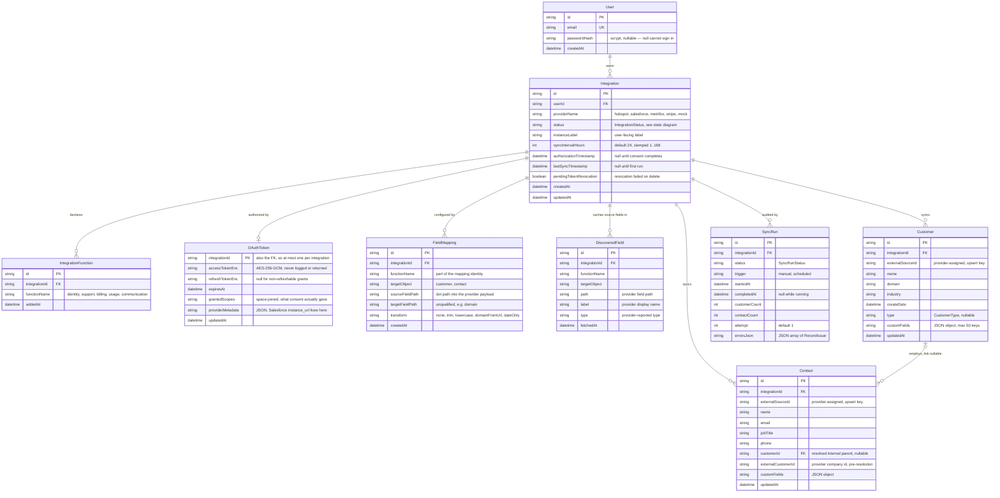
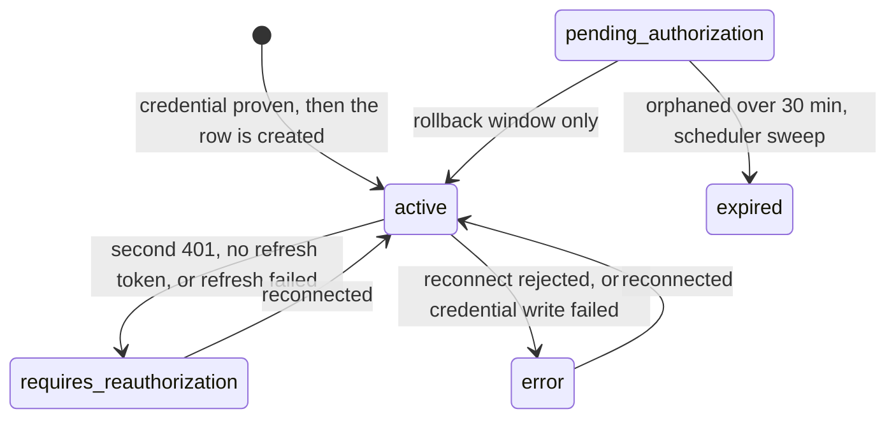

# Data model

Generated from [`prisma/schema.prisma`](../prisma/schema.prisma) and the
const-union types in [`src/core/types/common.ts`](../src/core/types/common.ts).
Nine tables, one ownership spine: **everything hangs off `Integration`**.

> **Also available as an interactive page** —
> [`docs/diagrams/data-model.html`](./diagrams/data-model.html): the entity diagram
> with hover-to-isolate, a control that shows what a delete cascades through, and
> the status lifecycle. Open it in a browser; it needs no server.

---

## Entity relationships

### Reading the spine

`Integration` is the tenancy boundary. Every synced record, mapping rule,
discovered field, and run carries `integrationId` — which is why deleting one
integration is a clean cascade, and why no query leaks another integration's
data by omission.

`User` sits above it only for ownership, and that ownership is enforced: every
request-scoped read of an integration goes through `findIntegrationForUser`,
which puts `userId` in the `where` clause. The unscoped `findIntegration`
survives for the scheduler, which sweeps every user and has none in scope.

As shipped there is still one seeded account (see
[Known limitations](../README.md#known-limitations)) — but it is a real one now,
authenticated by Auth.js against `passwordHash`.

Two relationships carry the design load:

- **`Integration` → `IntegrationFunction` is one-to-many, not one-to-one.** A
  single HubSpot connection can serve `identity` *and* `support`. The OAuth
  scopes requested are the union across these rows, which is why the function
  set has to be known before authorization.
- **`Customer` → `Contact` is optional on the contact side.** Providers hand
  back their *own* company id, never our UUID. Customers are written first to
  build an `external → internal` index; a contact whose company will not resolve
  is kept with `customerId = null` and its `externalCustomerId` retained, so a
  later sync links it once that company arrives.

---

## Referential actions

| Parent | Child | On parent delete |
|---|---|---|
| `User` | `Integration` | `Cascade` |
| `Integration` | `IntegrationFunction`, `OAuthToken`, `FieldMapping`, `DiscoveredField`, `Customer`, `Contact`, `SyncRun` | `Cascade` |
| `Customer` | `Contact` | `SetNull` — the contact survives, unlinked |

`Customer` → `Contact` is deliberately not a cascade: losing a company record
should not silently delete the people attached to it.

---

## Uniqueness — where identity actually lives

| Table | Constraint | Why |
|---|---|---|
| `User` | `email` | The stable handle the demo looks the user up by. |
| `Customer` | `(integrationId, externalSourceId)` | The upsert key. Re-running a sync updates rather than duplicates. |
| `Contact` | `(integrationId, externalSourceId)` | Same. |
| `IntegrationFunction` | `(integrationId, functionName)` | A function is declared once per integration. |
| `FieldMapping` | `(integrationId, functionName, targetObject, targetFieldPath)` | One rule per target field. Function and target object are part of the identity, because two functions on one integration can write to the same object. |
| `DiscoveredField` | `(integrationId, functionName, targetObject, path)` | Cache key. |
| `OAuthToken` | `integrationId` as the primary key | Structurally at most one live token per integration. |

Indexes beyond those: `Integration(userId)` and `Integration(status)` for the
scheduler sweep, `FieldMapping(integrationId)` and
`(integrationId, functionName)`, `Customer(integrationId)`,
`Contact(integrationId)` and `Contact(customerId)`,
`SyncRun(integrationId, startedAt)` for run-history ordering, and
`IntegrationFunction(functionName)`.

---

## Columns that are strings but are not really strings

Prisma supports neither `enum` nor `Json` on SQLite. Both are modelled as
`String` and constrained in application code, which keeps the schema portable —
moving to Postgres is a datasource swap plus promoting these columns to native
`enum` / `jsonb`.

### Enum-shaped

| Column | Legal values | Guard |
|---|---|---|
| `Integration.status` | `pending_authorization`, `active`, `expired`, `requires_reauthorization`, `error` | `isIntegrationStatus` |
| `Customer.type` | `prospect`, `customer`, `partner`, `vendor`, or null | `isCustomerType` |
| `FieldMapping.targetObject` | `customer`, `contact` | `isTargetObject` |
| `SyncRun.status` | `running`, `success`, `partial`, `failed`, `discarded` | `isSyncRunStatus` |
| `FieldMapping.transform` | `none`, `trim`, `lowercase`, `domainFromUrl`, `dateOnly` | [`transforms.ts`](../src/core/field-mapper/transforms.ts) |

Each guard lives beside its union in
[`src/core/types/common.ts`](../src/core/types/common.ts), so the type and its
runtime check cannot drift.

### JSON-shaped

Read and written only through
[`json-column.ts`](../src/core/repositories/json-column.ts).

| Column | Default | Shape |
|---|---|---|
| `Customer.customFields` | `{}` | `Record<string, unknown>`, max 50 keys |
| `Contact.customFields` | `{}` | `Record<string, unknown>` |
| `OAuthToken.providerMetadata` | `{}` | Provider extras from the token response, e.g. Salesforce `instance_url` |
| `SyncRun.errorsJson` | `[]` | `RecordIssue[]` — `{ sourceRecordId, targetObject, reason, fieldName?, severity }` |

---

## `Integration.status` lifecycle

The one column with real behaviour behind it. Every write goes through
`updateStatus` or `markAuthorized` in
[`integration-repository.ts`](../src/core/repositories/integration-repository.ts).

**`pending_authorization` is nearly unreachable, and that is the point.** A row
used to be inserted as soon as the user picked a provider, which meant every
failed or abandoned connect left one behind to be deleted by hand. The
configuration is now held as a draft
([`draft-store.ts`](../src/core/integrations/draft-store.ts)) and the row is
created only once a credential is proven, so an integration is `active` from the
moment it exists. The only way to observe `pending_authorization` is a crash
inside `createIntegrationFromDraft`, between the insert and `markAuthorized`,
where the compensating delete also failed to run — which is what the scheduler
sweep still exists to retire.

A failed *reconnect* is the deliberate exception: it sets `error` and keeps the
row, because an established integration may hold edited mappings and synced
records.

Only `active` integrations sync. The scheduler
([`scheduler.ts`](../src/core/sync/scheduler.ts)) skips everything else, and
`POST /api/integrations/[id]/sync`, the fields route, and the mapping page each
gate on it independently rather than trusting the caller.

`expired` is narrower than it sounds: it means *abandoned before authorization
ever completed*, not *token past `expiresAt`*. An expired access token on a live
integration is a refresh attempt; only a **failed** refresh moves the
integration, and it moves to `requires_reauthorization`.
