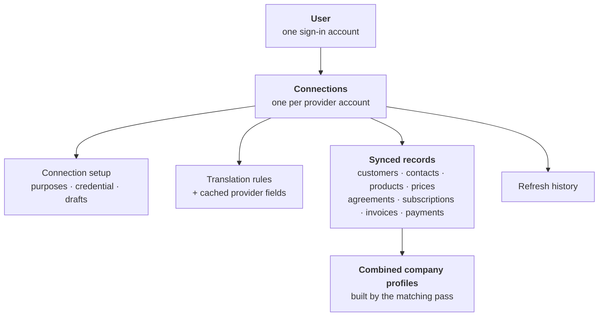
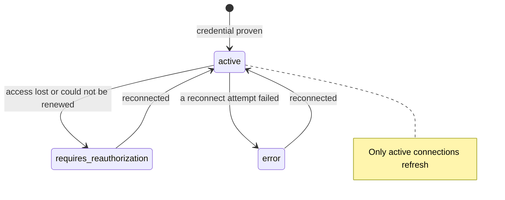

# Data model — what the platform stores

A "data model" is simply how information is organized inside the database: what
kinds of things are stored, what each one contains, and how they relate to each
other. This document describes all of it in everyday language.

The platform keeps **28 kinds of information** (in database terms, 28 *tables*).
They fall into six groups:

| Group | Tables | Belongs to |
|---|---|---|
| 1. Sign-in | 1 | The account owner |
| 2. Connections | 5 | The account owner |
| 3. Translation rules | 2 | One connection |
| 4. Synced records | 15 | One connection |
| 5. Company matching | 4 | The account owner |
| 6. Refresh history | 1 | One connection |

The engineering source of truth is
[`prisma/schema.prisma`](../prisma/schema.prisma); this document explains what
that file means, table by table. For how the data gets here, see
[`architecture.md`](./architecture.md).

---

## The big picture

The single most important idea in the model: **a connection is a sealed
container**. Everything that comes from one connected provider account —
records, translation rules, run history — carries that connection's identity,
so no query can mix one connection's data with another's by accident. The only
tables that deliberately sit outside a connection are the combined company
profiles, because they exist precisely to join records *across* connections.

---

## Group 1 — Sign-in (1 table)

| Table | What it holds |
|---|---|
| **User** | One sign-in account: an email address and a securely hashed password. Every connection, record, and combined profile belongs to one user. |

> Currently the platform is created with a single account at setup time; there
> is no self-service sign-up screen yet.

## Group 2 — Connections (5 tables)

| Table | What it holds | Why it matters |
|---|---|---|
| **Integration** | One connected provider account: which system, your label for it, its health, how often it refreshes, and its priority. | This is the container. Deleting it removes everything that came through it. |
| **IntegrationFunction** | One row per **purpose** the connection serves (Identity, Billing, …). | A connection can serve several purposes; the permissions requested are the combination of these rows. |
| **OAuthToken** | The encrypted credential: the access token, the refresh token (for sign-in connections), its expiry, the permissions actually granted, and provider-specific extras the API needs later. | Exactly one per connection. Includes pasted API keys too — they are stored and encrypted the same way. |
| **IntegrationDraft** | A half-finished connection setup, kept for 30 minutes. | Lets you retry a mistyped key without re-choosing the system and purposes. Deleted once the credential succeeds. |
| **OAuthState** | A short-lived, single-use security code used during "sign in and approve" redirects. | Prevents tampered redirects. It expires after 30 minutes and works exactly once. |

Two of these are *scratch* tables — `IntegrationDraft` and `OAuthState`. They
hold work in progress, not customer data, and losing either costs only a retry.
They exist as tables (rather than in the server's memory) because the step that
writes one and the step that reads it can land on different servers.

## Group 3 — Translation rules (2 tables)

| Table | What it holds |
|---|---|
| **FieldMapping** | One translation rule: which purpose and record type it belongs to, where the value comes from in the provider, which of our fields it fills, and the optional clean-up. |
| **DiscoveredField** | A cached list of the fields the provider currently offers, used to fill the dropdown in the editor. Re-read from the provider at most once an hour. |

Each rule is stored per purpose and per record type, so the same provider field
can feed two different features without the rules colliding.

## Group 4 — Synced records (15 tables)

These are the actual business records fetched from providers. Every one belongs
to exactly one connection, and every one is keyed by *(connection + the
provider's own id)* — which is what makes a refresh **update** a record instead
of creating a duplicate.

### Identity — companies and people (2 tables)

| Table | What it holds | Notes |
|---|---|---|
| **Customer** | A company as one system sees it: name, website domain, email, industry, type (prospect / customer / partner / vendor), and any custom extras. | Also remembers explicit cross-references to other systems, and which combined profile it resolved to. |
| **Contact** | A person attached to a customer: name, email, job title, phone. | The link to the company can be blank for a while if that company has not arrived yet — the contact is kept and links itself on a later refresh. |

### Catalog — what you sell (5 tables)

| Table | What it holds |
|---|---|
| **Product** | Something the company sells. |
| **Offering** | A purchasable version of a product — a plan or an item. A system that has no separate "item" concept (Stripe, for example) produces one offering per product. |
| **Price** | A specific amount, currency, and billing rhythm for an offering: for example 49 USD every month, or a one-time charge. |
| **Feature** | A reusable capability definition: a display name, a stable machine key such as `premium-support`, whether it is consumed by usage rather than granted as a fixed extra, and its unit. |
| **Entitlement** | The statement that one offering includes one feature, at the value/limit the provider states. |

Features and entitlements are separate on purpose: one shared feature
("api-access") can be attached to several offerings, and each attachment is its
own entitlement. So one feature is **one** row, while its attachments are
**many** rows.

### Agreements — what customers signed up for (5 tables)

| Table | What it holds |
|---|---|
| **Agreement** | The shared commercial record: one row per subscription, order form, contract, or deal. Says who it is for, which offering it is under, what kind it is, where it stands, and its dates. |
| **Subscription** | The recurring-billing details of a subscription-type agreement: the current period, trial dates, when cancellation was requested versus when it actually stops, the next renewal, the billing rhythm, and how money is collected. |
| **AgreementItem** | One priced line on an agreement — the base plan, a seat count, an add-on. Records quantity and what it points at (offering and price). Deliberately stores no amount: the price lives on the Price record, and totals are the provider's to state. |
| **AgreementEntitlement** | What *this subscriber actually gets* under this agreement, with plan defaults and per-customer overrides already folded together. Differs from the catalog Entitlement, which describes the standard offering. The two must never be added together. |
| **AgreementDiscount** | A discount on an agreement, exactly as stated: percentage, fixed amount, or free items; its status; when it starts and ends. |

An agreement's status uses one shared vocabulary across every provider:
*draft, trialing, active, past due, paused, canceled, expired* and *scheduled*
(agreed, but not started yet). Translating a provider's own wording into these
eight states happens once, in that provider's plug.

### Billing — bills and money (3 tables)

| Table | What it holds |
|---|---|
| **Invoice** | One bill: a human-readable number, its status (draft, open, paid, past due, void, uncollectible), who it is for, which agreement it belongs to, the amounts, and the key dates (issued, due, paid). |
| **InvoiceLine** | One line on a bill: description, quantity, unit amount, total amount, the service period it covers, and its kind (plan, add-on, usage, proration, discount, credit, or adjustment). |
| **Payment** | One movement of money: a payment or a refund, its amount and currency, when it was processed, the method, and any failure or dispute details. |

**Money is copied, never calculated.** Invoice totals are exactly the numbers
the billing system stated. The platform never adds up invoice lines to produce
a total, and never adds up payments to produce a "paid" figure — because
authorizations (which move no money) are deliberately not stored, that
arithmetic would be wrong exactly when it looked plausible. All amounts are in
the currency's smallest unit (cents, pence, yen) with no conversion anywhere.

## Group 5 — Company matching (4 tables)

These four belong to the owner rather than to a connection, because they exist
to join records *across* connections.

| Table | What it holds |
|---|---|
| **CustomerAccount** | One combined company profile: the resolved name, domain, email, industry, type and creation date, plus a record of **which connection supplied each field**. Rebuilt from scratch on every matching pass, so it can never drift from its sources. |
| **CustomerAccountKey** | The evidence that a company profile is "the same" as a record: each key it owns (an email address, a website domain, or an external reference), in both normalized and original form, with the source it came from and when it was first/last seen. |
| **IdentityAssertion** | A person's verdict that two customer records are the *same company*, or explicitly *not* one company, with an optional note. These outrank every automatic signal. |
| **IdentityResolutionRun** | One execution of the matching pass: how long it took, how many profiles were created/merged/cleaned up, how many records were linked, and any issues raised. |

Two safety details worth stating plainly:

- **A match key can belong to only one combined profile per owner.** That is
  enforced by the database itself, so two profiles claiming the same email
  become a visible conflict for a person to settle — never a silent overwrite.
- **Human verdicts are anchored to the original customer records**, not to the
  combined profiles. Profiles are created and rebuilt constantly; the records
  they are built from are stable. That is why a "same company" decision keeps
  working after every later refresh.

## Group 6 — Refresh history (1 table)

| Table | What it holds |
|---|---|
| **SyncRun** | One refresh attempt: whether it succeeded, was partial, failed, or was skipped because another refresh was running; what triggered it; start and finish times; how many records of each kind were written; and a reason for every record that was skipped or flagged. |

---

## Rules that apply everywhere

### One connection = one bucket

Every synced record, translation rule, cached field and refresh result belongs
to exactly one connection. Deleting a connection therefore removes its data
cleanly and completely. Combined company profiles are the exception, and
deliberately so — they belong to the owner because no single connection can see
a company that spans three of them.

### Update, don't duplicate

Every record is stored under *(connection + provider's own id)*. Refreshing
again finds the existing row and updates it. Running the same refresh ten times
leaves exactly the same number of rows as running it once.

### A blank means "the provider did not say"

Missing values are stored as blank, never as zero or "no". A product's
"still for sale" flag has **three** states: yes, no, and *not told* — and the
third is different from the second. The interface is careful to show them
differently.

### The amount of detail that is kept

- **Core fields** get their own column so they can be searched, sorted and
  shown in tables.
- **Extras** (up to 50 per record) are kept as flexible key–value pairs —
  useful for provider-specific details that do not deserve a column of their
  own.
- **Provider bags**: some commercial records keep the provider's own raw
  extra data untouched, exactly as received, for reference.

### What deleting something removes

| If you delete… | What happens |
|---|---|
| The owner account | Everything: connections, records, rules, profiles, history. |
| A connection | Its credential, its translation rules, and every record it synced. Nothing that came through other connections is touched. |
| A customer record | Its contacts survive with the link cleared; its agreements, invoices and payments survive unlinked. |
| A product | Its offerings survive, unlinked. |
| An offering | Prices and references survive, unlinked. |
| An invoice | Its lines go with it (they mean nothing alone); its payments survive, unlinked. |
| A combined company profile | The underlying customer records survive untouched; the next matching pass can rebuild a profile from them. |

The pattern: the platform deletes something else only when that something
means nothing on its own — an invoice line without its invoice, an agreement
line without its agreement. Everything that stands on its own (a person, a
bill, a payment) survives.

### The connection status lifecycle

Two rare states exist for unfinished setup: *pending authorization* (only
reachable if the server crashed in the moment between creating a connection
and confirming its credential, and the cleanup also failed — a periodic sweep
retires these after 30 minutes) and *expired* (setup was abandoned before the
credential was ever proven). Neither state means "the credential got old":
an aging sign-in credential is renewed automatically, and only a **failed**
renewal moves a live connection to *needs reconnect*.

### Refresh outcomes

Every refresh is recorded as one of five results: **running** (still in
progress), **success** (everything written), **partial** (some records were
skipped or flagged, each with a reason), **failed** (it could not continue;
whatever was already written stays), or **discarded** (another refresh for the
same connection was already running). The matching pass reports the same five
states.

### The four reconciled lists

Agreement lines, agreement entitlements, agreement discounts and invoice lines
are the only stored records that get **removed** during a refresh when the
provider no longer lists them — an add-on taken off, a line deleted from a
draft invoice. Deletion is protected by two conditions: the list must be part
of the mapping, and the provider must have finished sending the list. All other
record types are update-only; one that stops arriving stays until the
connection is deleted.

---

## All 28 tables at a glance

| # | Table | Group | In one line |
|---|---|---|---|
| 1 | User | Sign-in | One sign-in account. |
| 2 | Integration | Connections | One connected provider account (the container). |
| 3 | IntegrationFunction | Connections | One purpose a connection serves. |
| 4 | OAuthToken | Connections | The encrypted credential and granted permissions. |
| 5 | IntegrationDraft | Connections | A half-finished setup, kept 30 minutes. |
| 6 | OAuthState | Connections | A single-use security code for approval redirects. |
| 7 | FieldMapping | Translation rules | One "provider field → our field" rule. |
| 8 | DiscoveredField | Translation rules | Cached list of the provider's fields (1 hour). |
| 9 | Customer | Synced — Identity | A company as one system sees it. |
| 10 | Contact | Synced — Identity | A person at a company. |
| 11 | Product | Synced — Catalog | Something sold. |
| 12 | Offering | Synced — Catalog | A purchasable version of a product. |
| 13 | Price | Synced — Catalog | An amount, currency and billing rhythm. |
| 14 | Feature | Synced — Catalog | A reusable capability definition. |
| 15 | Entitlement | Synced — Catalog | An offering includes a feature, at a limit. |
| 16 | Agreement | Synced — Agreement | A subscription, order form, contract or deal. |
| 17 | Subscription | Synced — Agreement | Recurring-billing details of an agreement. |
| 18 | AgreementItem | Synced — Agreement | One priced line on an agreement. |
| 19 | AgreementEntitlement | Synced — Agreement | What this subscriber actually gets. |
| 20 | AgreementDiscount | Synced — Agreement | A discount on an agreement, as stated. |
| 21 | Invoice | Synced — Billing | One bill. |
| 22 | InvoiceLine | Synced — Billing | One line on a bill. |
| 23 | Payment | Synced — Billing | One money movement (payment or refund). |
| 24 | CustomerAccount | Company matching | One combined company profile. |
| 25 | CustomerAccountKey | Company matching | The evidence a profile owns (email, domain, reference). |
| 26 | IdentityAssertion | Company matching | A person's "same / not same company" verdict. |
| 27 | IdentityResolutionRun | Company matching | One execution of the matching pass. |
| 28 | SyncRun | Refresh history | One refresh attempt and its outcome. |

---

## For engineers

The authoritative definition of every column, constraint and delete rule is
[`prisma/schema.prisma`](../prisma/schema.prisma); this page describes the same
model without the technical detail. Two conventions in that file are
intentional and worth knowing before changing it:

- **Status and type columns are stored as text**, validated in application code
  against the shared unions in `src/core/types/common.ts`.
- **Structured extras are stored as serialized text** and always read and
  written through `src/core/repositories/json-column.ts`.

Both conventions date from when the test suite ran on SQLite, which supported
neither database enums nor a native JSON type through Prisma. Everything now
runs on PostgreSQL, which supports both, so promoting them is possible — but it
is a data migration plus a sweep through the repositories, tracked as a
follow-up rather than done silently.
