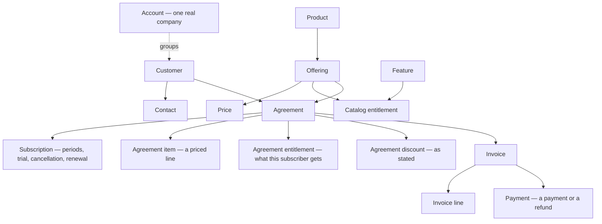

# The revenue graph, as this platform builds it

The [Revenue Graph Framework](./Revenue%20Graph%20Framework.md) describes where
this work is headed: a living model of every customer's relationship with the
business, agents that watch that model for opportunity and risk, and actions
that close the loop. This page is the status map for the same picture — which
parts of that graph this repository already builds, which are partial, and
which are not here at all.

Plain-language companions: [`README.md`](./README.md) for the overview,
[`architecture.md`](./architecture.md) for how the machinery works, and
[`data-model.md`](./data-model.md) for every stored table. An interactive
version with diagrams is
[`diagrams/revenue-graph.html`](./diagrams/revenue-graph.html).

## What this platform is, in framework terms

The framework has three layers — graph, agents, actions. This platform is the
data half of Layer 01: it connects to the systems a business already runs,
reads their records, translates everything into one schema (28 tables), and
merges each system's idea of a customer into one combined company profile.

There is no agent layer and no action layer in this codebase. Nothing here
detects a pattern, recommends anything, or acts. What exists is the substrate
those layers need: current, cleaned, matched records in one queryable store.

Two boundaries are worth stating before the mapping:

- **Read-only.** The platform reads from source systems; apart from a
  best-effort request to revoke access when a connection is deleted, nothing is
  ever written back to a provider. This is a deliberate line, and it matters
  for Layer 03 — actions would need write access that this codebase does not
  take.
- **Records, not events.** Refreshes update records in place; there is no
  stream of individual change events. Refresh history exists (`SyncRun`), but
  the framework's canonical event envelope (`occurred_at` / `effective_at` /
  `ingested_at`, idempotency key) is not implemented. The upsert key —
  connection plus the provider's own id — is this system's idempotency
  equivalent.

## The graph this project already materializes

Arrows show what references what, read roughly as the framework's causal order.

Entity by entity against the framework's sixteen:

| Framework entity | In this platform | Status |
|---|---|---|
| COMPANY, CUSTOMER_ACCOUNT | `Customer` (one system's record) plus `CustomerAccount` (the combined profile built by matching) | Built |
| WORKSPACE, USER, MEMBERSHIP | — (`Contact` is a person at the customer's company; `User` is this platform's own sign-in owner) | Not modeled |
| PRODUCT | `Product` | Built |
| OFFERING | `Offering` plus `Price` (the price is split into its own table) | Built |
| AGREEMENT | `Agreement` plus `Subscription`, `AgreementItem`, `AgreementEntitlement`, `AgreementDiscount` | Built — subscription type live today |
| ENTITLEMENT | `Entitlement` (catalog) plus `AgreementEntitlement` (effective) — two levels, never summed | Built |
| USAGE_EVENT | — | Not built; the Usage purpose is declared, no system serves it |
| CHARGE | — deliberately none; `InvoiceLine` is where billed amounts live | Deliberate absence |
| INVOICE | `Invoice` | Built |
| COST_EVENT | — | Not built |
| PAYMENT | `Payment` | Built |
| SIGNAL, RECOMMENDATION | — | Not built (agent layer) |
| Reliability / incidents | — | Not built |

Two of those rows deserve a note, because they match the framework's spirit
rather than its letter:

- **CHARGE is absent on purpose.** The word means three incompatible things
  across systems (a line on an invoice, a one-off item type, one provider's own
  charge object), so the schema refuses it — and `InvoiceLine` takes its role,
  because an invoice line *is* the billed amount.
- **ENTITLEMENT splits in two.** The framework's one entity is two facts here:
  what an offering includes (standard terms) and what one subscriber actually
  gets (overrides folded in). Collapsing them would double-count; keeping them
  apart is the same discipline the framework's parallel-states rule demands.

## The agreement is the hub here too

The framework's central structural claim is that AGREEMENT touches identity,
catalog, access, activity, and money at once. In this project it touches four
of the five — identity (the customer link), catalog (the offering link),
money (invoices hang off the agreement), and access (agreement entitlements are
the effective permissions). Activity is the missing axis: there is no usage
data anywhere yet.

The framework's "inside the agreement" objects against what is modeled:

| Framework object | Here | Notes |
|---|---|---|
| Agreement | `Agreement` | Shared node; four types: subscription, order form, contract, deal |
| Subscription | `Subscription` | Periods, trial, cancellation, next renewal |
| Order Form | agreement *type* only | Declared from day one, but no system writes one yet |
| Agreement Item | `AgreementItem` | One priced line |
| Term | Partial | Dates and billing rhythm live on `Agreement`/`Subscription`; there is no term record |
| Trial / Pilot | Partial | Trial start/end dates only |
| Proposal / Quote | — | Not modeled |
| Acceptance | — | Not modeled |
| Amendment | — | Not modeled; there is no per-agreement change history |
| Renewal | Partial | Renewal *dates*, not renewal terms |
| Cancellation | Partial | Requested date, effective date, period-end flag; no reason record |
| Discount / Concession | `AgreementDiscount` | Stated values only |

The agreement's own question list, answered by this schema today:

| The framework asks | This platform answers |
|---|---|
| What did the customer agree to? | Yes — agreement, items, entitlements, discounts |
| Which version was accepted or signed? | No — no acceptance or version records; refreshes update in place |
| How was it approved? | No |
| When did it become effective? | Yes — `effectiveDate`, `endDate` |
| What products, services, entitlements are included? | Yes — items and effective entitlements |
| What commercial commitments exist? | Partial — quantities and lines are stored; commitment balances are not |
| When can it change? | Partial — end and renewal dates, but not the terms governing change |
| What happens at renewal? | Partial — the date, not the terms |
| What happens when payment fails? | Partial — invoice `past_due` and failed payment with a reason; no dunning schedule |
| What happens when the customer cancels? | Partial — cancellation dates and flags; no reason or outcome |

Only Stripe, Chargebee and Stigg write agreements today. HubSpot, Salesforce,
Metrifox and the Mock CRM appear in the picker for Agreement but sync nothing —
the type discriminator exists precisely so their future order forms and
contracts are a new provider plug, not a migration against stored rows.

## Parallel states: structure yes, derivation not yet

The framework's most important rule is that an account never has one status —
commercial, payment, usage, cost, reliability and relationship states move
independently. This schema was built with that rule structural: every record
carries the status vocabulary of its own function, and nothing merges them.

| Framework axis | In this platform | Status |
|---|---|---|
| Commercial | `Agreement.status` — eight states, plus `Subscription` dates | Built |
| Payment | `Invoice.status`, `Payment.status` (failure reasons kept) | Built |
| Usage | — | Not built |
| Cost | — | Not built |
| Reliability | — | Not built |
| Relationship | — | Not built — nothing derives `churn_risk` or similar |

So the substrate is half in place. The framework's worked example — the same
usage curve meaning "voluntary disengagement" for one account and "our outage
hurt them" for another — needs usage *and* reliability alongside payment and
commercial. This platform has the last two and none of the first two, so the
incident-attribution logic cannot run on this data yet. What it does have is
the property that makes that logic possible later: no single status field
anywhere would have to be un-collapsed to get there.

## The two loops

| Framework loop | This platform's loop |
|---|---|
| detect → explain → recommend → act → write back | connect → refresh (fetch · translate · write) → reconcile the four lists → match companies → schedule the next refresh |

They join at the record tables. An agent layer would read exactly the tables
diagrammed above, after the matching pass, and its explanations would cite the
same fields this schema stores — statuses, dates, amounts, entitlements. What
the framework's loop adds, and this codebase does not have, is any path that
writes back: to the source systems (actions), or into the graph as new nodes
(signals and recommendations have no tables).

## Where this stands against the framework's build order

| Framework step | Here |
|---|---|
| 0 · Identity resolution and the event envelope | Identity resolution is built — evidence keys in strength order (cross-reference over email over domain), freemail refused as a domain key, human verdicts that outrank every automatic match. The event envelope is not; records are the unit, not events |
| 1 · Materialize the graph | Partial — identity, catalog, agreement (subscription live) and billing are queryable; usage, cost and reliability are absent. Agreement was built generically from day one, exactly as the framework demands |
| 2 · Parallel state dimensions | Partial — the per-record statuses exist and are never collapsed; no account-level derived views are computed |
| 3–5 · Agents, recommendations, selective autonomy | Not in this codebase |

The honest summary: this repository is the framework's Layer 01, and within it
the commercial and billing slices — identity, catalog, agreements so far as
subscriptions go, invoices, payments, and the company-matching spine — are
built. The activity, cost and reliability slices, and all of Layers 02 and 03,
are ahead.

## For engineers

- **What a function may write, in what order:** `src/core/object-schema.ts`
  (`FUNCTION_OBJECTS`, `FUNCTION_WRITE_ORDER` — parents before children,
  identity → catalog → agreement → billing).
- **Registration and permissions:** `src/core/bootstrap.ts` and each
  `src/core/providers/*/provider.ts` scope declaration.
- **Identity resolution:** `src/core/identity/` and
  `src/core/repositories/identity-repository.ts`.
- **Adding the missing slices:** a new purpose costs a registry entry, scope
  declarations per provider, a handler, an object schema and a table — the
  walk-through is in [`architecture.md`](./architecture.md).
- **Attach point for an agent layer:** read the matched tables after the
  resolution pass; every fact an explanation would cite is already stored
  per-record with its source connection recorded beside it.
